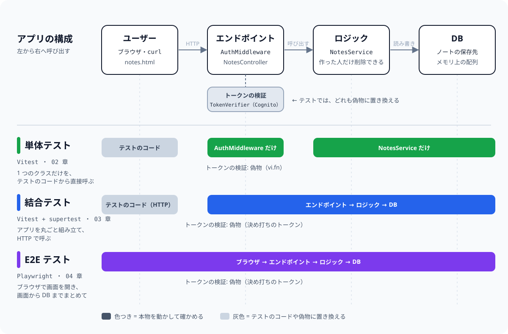

# NestJS のテスト ハンズオン

NestJS で作ったノートの API に、**単体テスト・結合テスト・E2E テスト** を書いていくハンズオンです。

- **単体テスト** — Vitest。サービスと middleware を 1 つずつ確かめる。相手は偽物（モック）に差し替える
- **結合テスト** — Vitest と supertest。アプリを丸ごと組み立てて、HTTP で呼んで確かめる
- **E2E テスト** — Playwright。ブラウザで画面を操作して、画面から API までをまとめて確かめる

テストする題材の「はじめのプロジェクト」（ノートの作成・一覧・削除の API と、一覧の画面）は ZIP で配ります。ほかのハンズオンを終えていなくても始められます。AWS のアカウントも要りません。

## このハンズオンで作るもの

| 章 | やること |
|---|---|
| 01. 準備 | Node.js 26 と VS Code を入れ、題材のプロジェクトを受け取って動かし、ファイルの役割を見る |
| 02. 単体テスト | サービスと middleware のテストを書く。トークンの検証を `vi.fn()` の偽物に差し替える。カバレッジを見る |
| 03. 結合テスト | アプリを丸ごと組み立て、supertest で HTTP で呼ぶ。トークンの検証を決め打ちのトークンを通す偽物に差し替える |
| 04. E2E テスト | Playwright で、API で作成・削除したノートが一覧の画面に反映されることを確かめる |

## 進め方

- 01 章で受け取る「はじめのプロジェクト」に、1 つのフォルダ（たとえば `~/handson/notes-app/`）で節ごとにテストを足していきます。
- ファイルを書き換える手順は、前の節との差分で示します。行頭が `+` の行を足し、`-` の行を消します。新しく作るファイルは、すべての行に `+` が付きます。
- 各節のページの最後に、その節を終えたときのディレクトリと、その状態のプロジェクトの ZIP があります。途中の節から始めるときは、ひとつ前の節の ZIP を展開し、`api/` で `npm install` を実行します。

前提:

- macOS 14 以降 / Windows 11（PowerShell 7）/ Linux（Ubuntu 22.04 以降）のどれか
- ターミナルの基本的な操作（`cd`・`ls`）ができる
- JavaScript か TypeScript を書いたことがある（NestJS は、はじめてでも進められます）

## 関連するハンズオン

NestJS のハンズオンは 3 本に分かれていて、どれから始めても進められます。Cognito と Entra ID のハンズオンも関連しています。つながりは [関連するハンズオン](./sections/RELATED.md) にまとめています。

- [NestJS で作る REST API](https://github.com/seekseep/nestjs-rest-api-handson)
- [NestJS と Cognito で認証と認可](https://github.com/seekseep/nestjs-cognito-auth-handson)
- NestJS のテスト（このハンズオン）
- [Cognito と Entra ID をローカルで練習する](https://github.com/seekseep/cognito-entra-id-emulation-handson)

## ドキュメントサイト

<https://seekseep.github.io/nestjs-testing-handson/>

## 注意事項

- 学習用リポジトリです
- テストでは、決め打ちのトークン（`alice-token` など）で認証します。本来のテストでの認証のやり方（テスト用のユーザーでサインインするなど）には触れません
