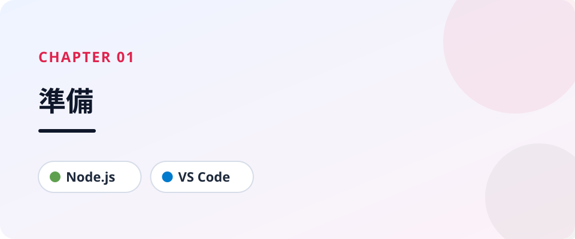

# 準備



このハンズオンで使う **Node.js 26（LTS）** と **VS Code** を入れます。どちらもすでに入っていれば、「[バージョンを確かめる](#バージョンを確かめる)」だけで次の章に進めます。

:::notice
LTS（Long Term Support）は長期サポート版のことです。偶数番号のバージョンが毎年 10 月ごろに LTS になり、約 3 年間セキュリティ修正が届きます。
:::

## お使いの OS を選ぶ

手順が OS で分かれるところでは、選んだ OS の手順だけを表示します。最初に、お使いの OS を選んでください。あとから、ページの上のナビゲーションバーの選択欄でも変えられます。

::platform-choice

:::::platform
::::macos
macOS では、ターミナル（「アプリケーション」→「ユーティリティ」→「ターミナル」）で進めます。05 章で使う Playwright は **macOS 14（Sonoma）以降** が必要です。
::::
::::windows
Windows では、**PowerShell 7** で進めます。コマンドの書き方が macOS・Linux と違うところは、Windows の書き方を表示します。WSL は使いません。

**必要なスペック**

| 項目 | 必要なもの |
|---|---|
| OS | Windows 11（Home・Pro どちらでも）。05 章で使う Playwright が Windows 11 以降を必要とします |
| CPU | 64 ビット |
| メモリ | 8 GB 以上（16 GB あると、エディタとブラウザとテストを同時に動かしても快適です） |
| ディスクの空き | 5 GB 以上（Node.js・VS Code・`node_modules`・Playwright のブラウザ） |
| シェル | PowerShell 7（下で入れます） |

**PowerShell 7 を入れる**

Windows に最初から入っている「Windows PowerShell」（5.1）ではなく、新しい PowerShell 7 を使います。5.1 では、`&&` でコマンドをつなげない・`curl` が別のコマンドになっている、など、このハンズオンのコマンドがそのままでは動かないためです。

スタートメニューから「Windows PowerShell」を開き、次のコマンドで入れます。

```powershell
winget install --id Microsoft.PowerShell --source winget
```

入れたら、スタートメニューから **PowerShell 7**（`pwsh`）を開きます。以降のコマンドは、すべて PowerShell 7 で実行します。

```powershell
$PSVersionTable.PSVersion
```

`7.` から始まる番号が出れば大丈夫です。
::::
::::linux
Linux では、ふだんのターミナルで進めます。05 章で使う Playwright は **Ubuntu 22.04・24.04・26.04、Debian 12・13** で動きます。
::::
:::::

## Node.js を入れる

まず、もう入っているかを確かめます。

```bash
node -v
```

`v26.` から始まる番号が出れば、Node.js 26 はもう入っています。「[VS Code を入れる](#vs-code-を入れる)」に進んでください。`command not found` と出るときや、ほかのバージョンが出るときは、[Node.js のダウンロードのページ](https://nodejs.org/ja/download) を開き、バージョンに **v26（LTS）** を選んで入れます。

:::::platform
::::macos
macOS 用のインストーラー（`.pkg`）をダウンロードして開き、画面の案内に従って進めます。
::::
::::windows
Windows 用のインストーラー（`.msi`）をダウンロードして開き、画面の案内に従って進めます。winget で入れることもできます。

```powershell
winget install OpenJS.NodeJS.LTS
```

`OpenJS.NodeJS.LTS` は、その時点の LTS を入れます。2026 年 10 月から 2027 年 10 月までは Node.js 26 です。
::::
::::linux
OS に **Linux** を選び、表示されたコマンドをターミナルで実行します。Ubuntu の `apt install nodejs` で入る Node.js は古いことが多いので、使いません。
::::
:::::

入れたら、ターミナル（Windows では PowerShell 7）を開き直します。

:::notice
プロジェクトごとに Node.js のバージョンを切り替えたい人は、nvm・fnm・Volta などのバージョン管理ツールで入れてもかまいません。`node -v` で `v26.` から始まる番号が出れば大丈夫です。
:::

## VS Code を入れる

エディタには [Visual Studio Code](https://code.visualstudio.com/)（VS Code）を使います。コードの編集と同じウィンドウでターミナルを使えるので、テストの実行とコードの確認を行き来しやすくなります。

[ダウンロードのページ](https://code.visualstudio.com/download) から、お使いの OS のものを入れます。

:::::platform
::::macos
`.zip` を開くと `Visual Studio Code.app` ができるので、「アプリケーション」フォルダに移します。

VS Code を開き、コマンドパレット（`Cmd + Shift + P`）で **Shell Command: Install 'code' command in PATH** を実行すると、ターミナルから `code .` でフォルダを開けるようになります。
::::
::::windows
ユーザー インストーラー（User Installer）をダウンロードして開き、画面の案内に従って進めます。「PATH への追加」にチェックが入っていれば、PowerShell から `code .` でフォルダを開けます。winget で入れることもできます。

```powershell
winget install Microsoft.VisualStudioCode
```
::::
::::linux
Ubuntu・Debian なら `.deb` をダウンロードして入れます。

```bash
sudo apt install ./<ダウンロードしたファイル>.deb
```
::::
:::::

使い方と、入れておくと便利な拡張機能は [開発ツール](../../TOOLS.md) にまとめています。

## バージョンを確かめる

```bash
node -v
npm -v
```

```text
v26.13.1
11.12.1
```

`v26.` から始まっていれば大丈夫です（細かい番号は入れた日によって違います）。npm は Node.js といっしょに入るパッケージマネージャーで、NestJS やテストの道具を入れるときに使います。

```bash
code --version
```

VS Code のバージョンの番号が出れば、ターミナルから `code` を使えます。

## 参考にした公式ドキュメント

この節は、次の公式ドキュメントをもとに書いています。

- [Node.js: ダウンロード](https://nodejs.org/ja/download) … 入れ方（インストーラー・パッケージマネージャー）
- [Node.js: Previous Releases](https://nodejs.org/en/about/previous-releases) … LTS の決まりと、各バージョンのサポート期間
- [Microsoft Learn: Windows への PowerShell のインストール](https://learn.microsoft.com/ja-jp/powershell/scripting/install/installing-powershell-on-windows) … winget で PowerShell 7 を入れる方法
- [Visual Studio Code: Setup Overview](https://code.visualstudio.com/docs/setup/setup-overview) … OS ごとの入れ方
- [Visual Studio Code: Requirements](https://code.visualstudio.com/docs/supporting/requirements) … VS Code が動く環境
- [Playwright: Installation](https://playwright.dev/docs/intro) … Playwright が動く OS（System requirements）

:::faq

### Node.js 26 ではなく 24 でも動く？

このハンズオンで使う NestJS 12・Vitest・Playwright は、Node.js 24 でも動きます。ただし、手順や出力は Node.js 26 で確かめています。迷ったら 26 を使ってください。

### Node.js を 2 つの方法で入れてしまった

公式サイトのインストーラー・Homebrew・nvm などで重ねて入れると、どれが使われているか分かりにくくなります。`which node`（Windows の PowerShell では `Get-Command node`）で、使われている Node.js の場所を確かめてください。使わないほうをアンインストールするか、`PATH` の順番を見直します。

### Windows 10 では進められない？

05 章で使う Playwright が Windows 11 以降を必要とするので、このハンズオンでは Windows 11 を前提にしています。Windows 10 は、2025 年 10 月に Microsoft のサポートが終わっています。

:::
