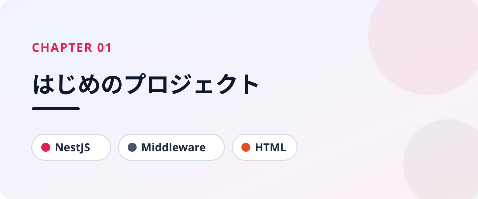
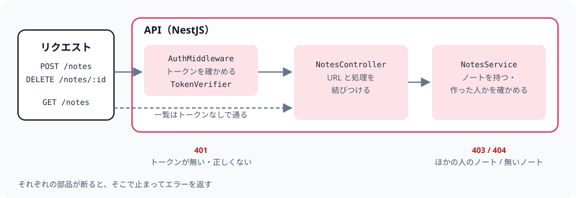

# はじめのプロジェクト



テストする題材の「はじめのプロジェクト」をダウンロードして動かし、どのファイルが何をしているかを見ます。プロジェクトは NestJS の API 1 つで、ノートを扱う API が 3 つあります。

| API | トークン | すること |
|---|---|---|
| `POST /notes` | 要る | ノートを作る。作った人（トークンのユーザー）を `ownerId` に入れる |
| `GET /notes` | 要らない | ノートの一覧を返す |
| `DELETE /notes/:id` | 要る | ノートを消す。作った人でなければ `403`、無ければ `404` |

ノートの一覧を見る画面（`/notes.html`）も、API が配ります。

## ダウンロードして動かす

:::download
[はじめのプロジェクトをダウンロード](./project.zip)
:::

ZIP を展開してできる `01-setup-02-starter-project/` を、`notes-app/` のような名前に変えて好きな場所に置きます。このフォルダに、節ごとにテストを足していきます。

フォルダを VS Code で開き、ターミナルで `api/` に入って、ライブラリを入れてから起動します。

```bash
cd api
npm install
npm start
```

```text
[Nest] 12345  - WARN [TokenVerifier] COGNITO_USER_POOL_ID・COGNITO_CLIENT_ID が無いので、トークンはすべて 401 にします
...
[Nest] 12345  - LOG [NestApplication] Nest application successfully started
```

もう 1 つターミナルを開いて（VS Code のターミナルの右上の **＋**）、API を呼んでみます。一覧はトークンなしで見られます。

```bash
curl http://localhost:3000/notes
```

```text
[]
```

作成はトークンが要るので、トークンを付けないと `401` です。

```bash
curl -X POST http://localhost:3000/notes -H "content-type: application/json" -d '{"text":"牛乳を買う"}'
```

```text
{"message":"Missing bearer token","error":"Unauthorized","statusCode":401}
```

それらしいトークンを付けても、`401` のままです。

```bash
curl -X POST http://localhost:3000/notes -H "Authorization: Bearer alice-token" -H "content-type: application/json" -d '{"text":"牛乳を買う"}'
```

```text
{"message":"Invalid token","error":"Unauthorized","statusCode":401}
```

これで正しく動いています。このプロジェクトはトークンを **Amazon Cognito** で検証する作りで、Cognito の設定が無いときは、どのトークンも断ります（起動のログの `WARN`）。

:::notice
**このハンズオンでは、Cognito（AWS のアカウント）は要りません。** テストでは、トークンの検証を「`alice-token` を送ったら alice とみなす」偽物に差し替えて動かします（03 章・04 章）。

API を止めるときは、`npm start` のターミナルで Ctrl + C を押します。
:::

## リクエストの流れ



1. **AuthMiddleware**（middleware）… 作成と削除のときだけ動きます。`Authorization: Bearer <トークン>` のトークンを `TokenVerifier` に確かめてもらい、正しければユーザーを `req.user` に入れて先へ通します。正しくなければ `401`
2. **NotesController**（コントローラー）… URL（`POST /notes` など）と処理を結びつけ、`NotesService` を呼びます
3. **NotesService**（サービス）… ノートを持ち、作成・一覧・削除をします。削除のとき、作った人でなければ `403`、無ければ `404`

部品が分かれているので、テストでも「middleware だけ」「サービスだけ」を取り出して確かめられます（02 章）。

## ファイルの役割

中身は、ページの最後の「この節を終えたときのディレクトリ」で開いて読めます。

| ファイル | 役割 |
|---|---|
| `src/main.ts` | 起動する。`public/` の画面を配る |
| `src/app.module.ts` | アプリ全体のモジュール。作成と削除にだけ `AuthMiddleware` を掛ける |
| `src/notes/notes.controller.ts` | ノートの API の URL |
| `src/notes/notes.service.ts` | ノートを持つ（メモリ上。API を止めると消える）。作った人かどうかの判定もここ |
| `src/auth/auth.middleware.ts` | トークンを確かめる middleware |
| `src/auth/token-verifier.ts` | トークンを検証する `TokenVerifier`。本物は Cognito のトークンを確かめる |
| `public/notes.html` | ノートの一覧の画面 |

## TokenVerifier を差し替えてテストする

トークンの検証は `TokenVerifier` というクラスにまとめてあり、`AuthMiddleware` は DI（依存性の注入）で `TokenVerifier` を受け取ります。`TokenVerifier` は環境変数 `COGNITO_USER_POOL_ID`・`COGNITO_CLIENT_ID` を読み、無ければどのトークンも `401` にします。

テストでは、この `TokenVerifier` だけを偽物に差し替えます。middleware やサービスはそのまま使うので、「トークンが無ければ 401」「ほかの人のノートは 403」といった決まりを、Cognito 無しで確かめられます。トークンの検証をクラスに切り出してあるのは、このためです。

## 参考にした公式ドキュメント

この節は、次の公式ドキュメントをもとに書いています。

- [NestJS: Model-View-Controller](https://docs.nestjs.com/http/mvc) … `useStaticAssets()` で `public/` を配る
- [NestJS: Middleware](https://docs.nestjs.com/middleware) … `NestMiddleware` と、`consumer.apply().forRoutes()` で掛ける URL とメソッドを選ぶ

## この節を終えたときのディレクトリ

::tree

:::download
[この節を終えた状態をダウンロード](./project.zip)
:::

:::faq

### `EADDRINUSE: address already in use :::3000` と出る

3000 番を、ほかのプログラムが使っています。前に起動した API が残っていないか確かめてください。

### `npm install` で `npm warn` や `vulnerabilities` と出る

ライブラリについてのお知らせで、エラーではありません。そのまま進めてかまいません。

:::
