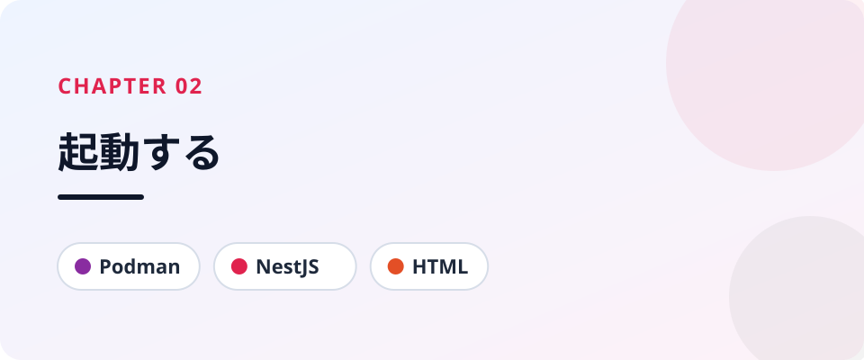

# 起動する



テストする題材の「はじめのプロジェクト」をダウンロードして動かします。プロジェクトは NestJS の API 1 つで、ノートの作成（`POST /notes`）・一覧（`GET /notes`）・削除（`DELETE /notes/:id`）と、一覧の画面（`/notes.html`）があります。

## ダウンロードして動かす

:::download
[はじめのプロジェクトをダウンロード](./project.zip)
:::

ZIP を展開してできる `02-project-01-start/` を、`notes-app/` のような名前に変えて好きな場所に置きます。このフォルダに、節ごとにテストを足していきます。

フォルダを VS Code で開き、ターミナルで `api/` に入って、ライブラリを入れてから起動します。

```bash
cd api
npm install
npm start
```

```text
[Nest] 12345  - WARN [TokenVerifier] COGNITO_USER_POOL_ID・COGNITO_CLIENT_ID が無いので、トークンはすべて 401 にします
...
[Nest] 12345  - LOG [NestApplication] Nest application successfully started
```

もう 1 つターミナルを開いて（VS Code のターミナルの右上の **＋**）、API を呼んでみます。一覧はトークンなしで見られます。

```bash
curl http://localhost:3000/notes
```

```text
[]
```

ブラウザで <http://localhost:3000/notes.html> を開くと、一覧の画面に「ノートはまだありません」と出ます。

作成はトークンが要るので、トークンを付けないと `401` です。

```bash
curl -X POST http://localhost:3000/notes -H "content-type: application/json" -d '{"text":"牛乳を買う"}'
```

```text
{"message":"Missing bearer token","error":"Unauthorized","statusCode":401}
```

それらしいトークンを付けても、`401` のままです。

```bash
curl -X POST http://localhost:3000/notes -H "Authorization: Bearer alice-token" -H "content-type: application/json" -d '{"text":"牛乳を買う"}'
```

```text
{"message":"Invalid token","error":"Unauthorized","statusCode":401}
```

これで正しく動いています。このプロジェクトはトークンを **Amazon Cognito** で検証する作りで、Cognito の設定が無いときは、どのトークンも断ります（起動のログの `WARN`）。

:::notice
**このハンズオンでは、Cognito（AWS のアカウント）は要りません。** テストでは、トークンの検証を「`alice-token` を送ったら alice とみなす」偽物に差し替えて動かします（04 章・05 章）。

API を止めるときは、`npm start` のターミナルで Ctrl + C を押します。
:::

## 参考にした公式ドキュメント

この節は、次の公式ドキュメントをもとに書いています。

- [NestJS: First steps](https://docs.nestjs.com/first-steps) … `npm run start` での起動

## この節を終えたときのディレクトリ

::tree

:::download
[この節を終えた状態をダウンロード](./project.zip)
:::

:::faq

### `EADDRINUSE: address already in use :::3000` と出る

3000 番を、ほかのプログラムが使っています。前に起動した API が残っていないか確かめてください。

### `npm install` で `npm warn` や `vulnerabilities` と出る

ライブラリについてのお知らせで、エラーではありません。そのまま進めてかまいません。

:::
