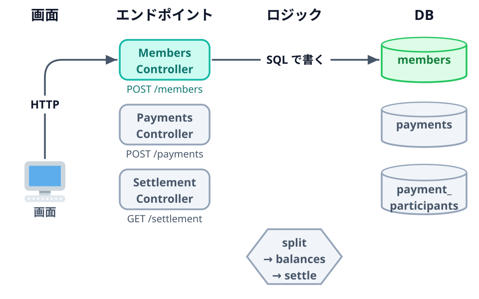
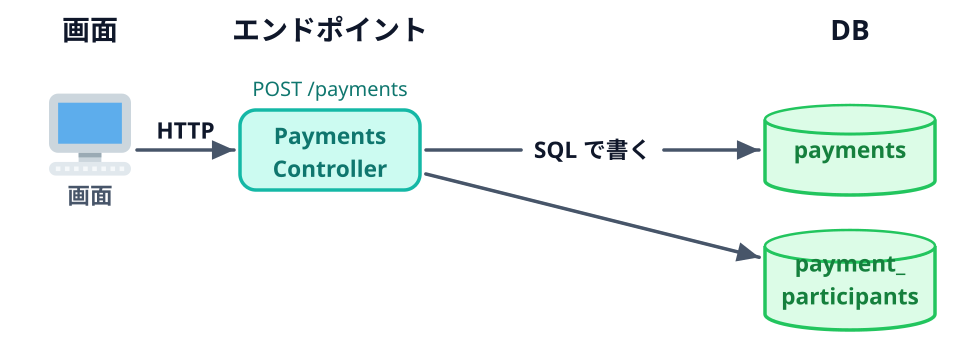
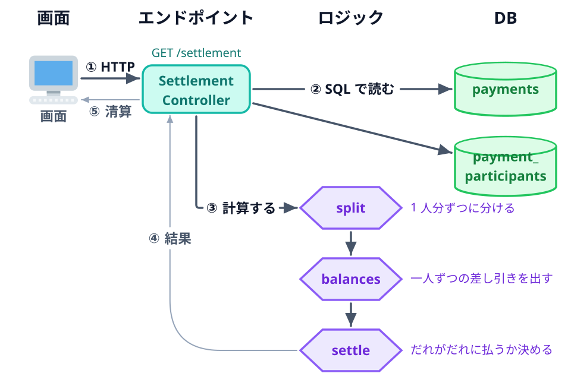
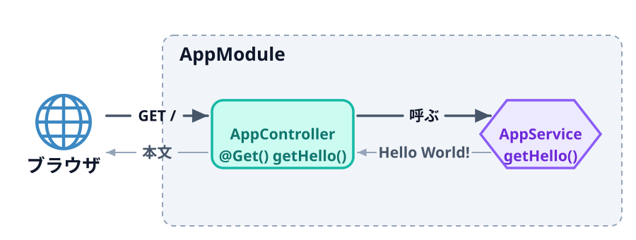

# リクエストの流れ


前の節で動かしたアプリのコードを読み、画面からのリクエストがどこを通るかを見ます。中身は、[起動する](../01-start/LECTURE.md) のページの最後のディレクトリか、手元の `api/` で開いて読めます。

アプリは、次の 4 つでできています。

| 部分 | ファイル | すること |
|---|---|---|
| 画面 | `public/index.html` | API を `fetch` で呼び、結果を表示する。`web` のコンテナが配る |
| エンドポイント | `src/members/members.controller.ts` など | URL ごとに、リクエストを受け取って応答を返す（コントローラー） |
| | `src/main.ts` | 起動する。画面（3000 番）とは別のポートから呼ばれるので、`enableCors()` で受け付ける |
| ロジック | `src/settlement/settle.ts` | 清算の計算。DB も HTTP も使わない関数 |
| DB | `src/database.ts` | SQLite のファイル（`DB_PATH`）を開き、表が無ければ作る |

DB の表は 3 つです。

| 表 | 列 | 入るもの |
|---|---|---|
| `members` | `id`・`name` | メンバー |
| `payments` | `id`・`payerId`・`amount`・`memo` | 立て替え（誰が・いくら・何に） |
| `payment_participants` | `paymentId`・`memberId` | 立て替えごとの、対象の人 |

このアプリは、素直に実装した形です。DB を開くことも SQL も、コントローラーに直接書いてあります。そのため、計算の関数のほかは、DB や HTTP 無しでは確かめにくくなっています。06 章で、NestJS の形に分けて直します。

## メンバーを足す



画面で **メンバーを足す** を押すと、`POST /members` が `MembersController` に届きます。コントローラーは、SQL で `members` の表に 1 行書きます。

## 立て替えを記録する



**立て替えを記録する** を押すと、`POST /payments` が `PaymentsController` に届きます。立て替えを `payments` に 1 行、対象の人を `payment_participants` に 1 人 1 行ずつ書きます。

## 清算を見る



画面は、表示を描き直すたびに `GET /settlement` を呼びます。`SettlementController` は、① リクエストを受け取り、② SQL で立て替えを読み、③ ロジックの関数で計算して、④ 清算を返します。

`settle.ts` の 3 つの関数は、次の順に使います。

| 関数 | すること | 例 |
|---|---|---|
| `split(amount, count)` | 金額を人数で分ける。1 円単位で、余った 1 円は前の人から順に足し、合計を元の金額と同じにする | `split(10000, 3)` → `[3334, 3333, 3333]` |
| `balances(payments)` | 一人ずつ「払った額 − 負担する額」を出す（中で `split` を使う） | A が 3 人分の 10,000 円を払う → A は `+6666`、B・C は `-3333` |
| `settle(balances)` | 誰が誰にいくら払うかを出す。いちばん多く払う人から、いちばん多く受け取る人へ払うことをくり返し、払う回数を少なくする | B → A 3,333 円、C → A 3,333 円 |

## NestJS がリクエストを届けるしくみ

コントローラーは、`@Controller()` に書いたパスと、メソッドに付けた `@Get()`・`@Post()` で、どのリクエストを受け取るかが決まります。

:::code{filepath="api/src/members/members.controller.ts"}
```ts
@Controller('members')
export class MembersController {
  // POST /members … メンバーを足す
  @Post()
  create(@Body() body: { name: string }): Member {
```
:::

`nest new` が作った `AppController` と `AppService` も、そのまま残っています。<http://localhost:3001> を開くと `Hello World!` が返ります。



:::code{filepath="api/src/app.controller.ts"}
```ts
@Controller()
export class AppController {
  constructor(private readonly appService: AppService) {}

  @Get()
  getHello(): string {
    return this.appService.getHello();
  }
}
```
:::

`constructor(private readonly appService: AppService)` と書くだけで、NestJS が `AppService` のインスタンスを作って渡してくれます。これを **依存性の注入（DI）** と呼びます。割り勘のコントローラーは DI を使わず、自分で DB を開いています。06 章で、DB や SQL も DI で受け取る形に直します。

## 参考にした公式ドキュメント

この節は、次の公式ドキュメントをもとに書いています。

- [NestJS: Controllers](https://docs.nestjs.com/controllers) … `@Controller()`・`@Get()`・`@Post()`・`@Body()` とルートの決まり方
- [NestJS: Providers](https://docs.nestjs.com/providers) … サービスとコンストラクターでの依存性の注入
- [NestJS: CORS](https://docs.nestjs.com/security/cors) … `enableCors()`
- [Node.js: SQLite](https://nodejs.org/docs/latest-v26.x/api/sqlite.html) … `DatabaseSync`・`prepare()`・`run()` が返す `lastInsertRowid`
