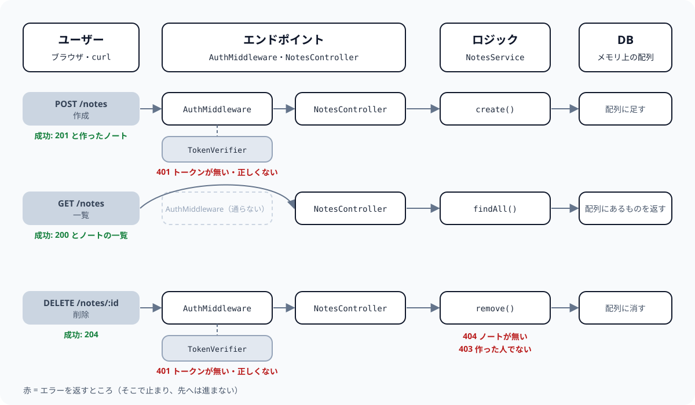

# リクエストの流れ

前の節で動かしたプロジェクトのコードを読み、1 つのリクエストがどこを通るかを見ます。中身は、[起動する](../01-start/LECTURE.md) のページの最後のディレクトリか、手元の `api/` で開いて読めます。

## ユーザー・エンドポイント・ロジック・DB

| 部分 | ファイル | すること |
|---|---|---|
| ユーザー | `public/notes.html`・curl | API を呼ぶ。`src/main.ts` が `public/` の画面を配る |
| エンドポイント | `src/app.module.ts` | 作成と削除にだけ `AuthMiddleware` を掛ける |
| | `src/auth/auth.middleware.ts` | `Authorization: Bearer <トークン>` のトークンを `TokenVerifier` に確かめてもらい、ユーザーを `req.user` に入れて先へ通す |
| | `src/auth/token-verifier.ts` | トークンを検証する。正しくなければ `401` |
| | `src/notes/notes.controller.ts` | URL（`POST /notes` など）と処理を結びつけ、`NotesService` を呼ぶ |
| ロジック | `src/notes/notes.service.ts` | 作成・一覧・削除。削除のとき、ノートが無ければ `404`、作った人でなければ `403` |
| DB | `src/notes/notes.service.ts` の `notes` | ノートを入れるメモリ上の配列。API を止めると消える |

## API ごとの流れ

| API | 通るところ | 返るもの |
|---|---|---|
| `POST /notes` | `AuthMiddleware` → `TokenVerifier` → `NotesController` → `NotesService` → 配列に足す | `201` と作ったノート。トークンが無い・正しくなければ `TokenVerifier` で `401` |
| `GET /notes` | `NotesController` → `NotesService` → 配列を返す（`AuthMiddleware` は通らない） | `200` とノートの一覧 |
| `DELETE /notes/:id` | `AuthMiddleware` → `TokenVerifier` → `NotesController` → `NotesService` → 配列から消す | `204`。`TokenVerifier` で `401`、`NotesService` で `404`・`403` |

## TokenVerifier を差し替えてテストする

`AuthMiddleware` は DI（依存性の注入）で `TokenVerifier` を受け取ります。`TokenVerifier` は環境変数 `COGNITO_USER_POOL_ID`・`COGNITO_CLIENT_ID` を読み、無ければどのトークンも `401` にします。

テストでは、この `TokenVerifier` だけを偽物に差し替えます。middleware やサービスはそのまま使うので、「トークンが無ければ 401」「ほかの人のノートは 403」といった決まりを、Cognito 無しで確かめられます。部品が分かれているので、「middleware だけ」「サービスだけ」を取り出して確かめることもできます（03 章）。

## 参考にした公式ドキュメント

この節は、次の公式ドキュメントをもとに書いています。

- [NestJS: Model-View-Controller](https://docs.nestjs.com/http/mvc) … `useStaticAssets()` で `public/` を配る
- [NestJS: Middleware](https://docs.nestjs.com/middleware) … `NestMiddleware` と、`consumer.apply().forRoutes()` で掛ける URL とメソッドを選ぶ
