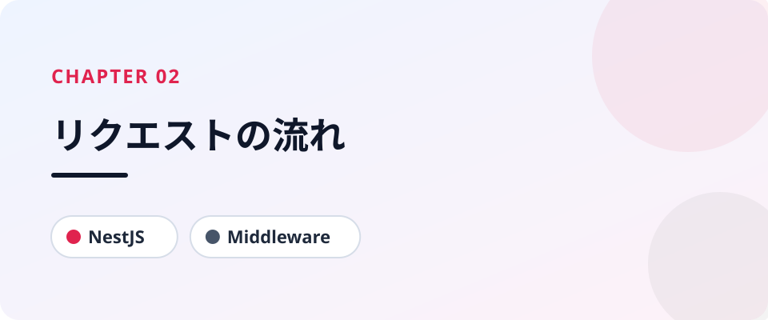

# リクエストの流れ

前の節で動かしたアプリのコードを読み、画面からのリクエストがどこを通るかを見ます。中身は、[起動する](../01-start/LECTURE.md) のページの最後のディレクトリか、手元の `api/` で開いて読めます。

## 画面・エンドポイント・ロジック・DB

| 部分 | ファイル | すること |
|---|---|---|
| 画面 | `public/index.html` | API を `fetch` で呼び、結果を表示する。`web` のコンテナが配る |
| エンドポイント | `src/main.ts` | 起動する。画面（3000 番）とは別のポートから呼ばれるので、`enableCors()` で受け付ける |
| | `src/members/members.controller.ts` | `POST /members`・`GET /members`。SQL で `members` の表を読み書きする |
| | `src/payments/payments.controller.ts` | `POST /payments`・`GET /payments`。SQL で `payments`・`payment_participants` の表を読み書きする |
| | `src/settlement/settlement.controller.ts` | `GET /settlement`。SQL で立て替えを読み、ロジックの関数で清算を計算して返す |
| ロジック | `src/settlement/settle.ts` | 清算の計算。DB も HTTP も使わない関数 |
| DB | `src/database.ts` | SQLite のファイル（`DB_PATH`）を開き、表が無ければ作る。コンテナでは、ファイルをボリュームに置く |

## DB の表

| 表 | 列 | 入るもの |
|---|---|---|
| `members` | `id`・`name` | メンバー |
| `payments` | `id`・`payerId`・`amount`・`memo` | 立て替え（誰が・いくら・何に） |
| `payment_participants` | `paymentId`・`memberId` | 立て替えごとの、対象の人 |

## 清算の計算

`GET /settlement` は、`settle.ts` の 3 つの関数を順に使います。

| 関数 | すること | 例 |
|---|---|---|
| `split(amount, count)` | 金額を人数で分ける。1 円単位で、余った 1 円は前の人から順に足し、合計を元の金額と同じにする | `split(10000, 3)` → `[3334, 3333, 3333]` |
| `balances(payments)` | 一人ずつ「払った額 − 負担する額」を出す | A が 3 人分の 10,000 円を払う → A は `+6666`、B・C は `-3333` |
| `settle(balances)` | 誰が誰にいくら払うかを出す。いちばん多く払う人から、いちばん多く受け取る人へ払うことをくり返し、払う回数を少なくする | B → A 3,333 円、C → A 3,333 円 |

このアプリは、素直に実装した形です。DB を開くことも SQL も、コントローラーに直接書いてあるので、計算の関数のほかは、DB や HTTP 無しでは確かめにくくなっています。06 章で、NestJS の形に分けて直します。

## 参考にした公式ドキュメント

この節は、次の公式ドキュメントをもとに書いています。

- [NestJS: Controllers](https://docs.nestjs.com/controllers) … `@Controller()`・`@Get()`・`@Post()`・`@Body()`
- [NestJS: CORS](https://docs.nestjs.com/security/cors) … `enableCors()`
- [Node.js: SQLite](https://nodejs.org/docs/latest-v26.x/api/sqlite.html) … `DatabaseSync`・`prepare()`・`run()` が返す `lastInsertRowid`
