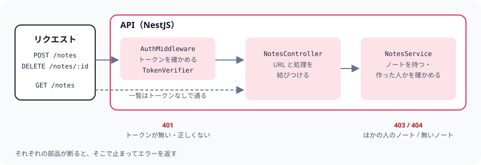

# はじめのプロジェクト


テストを書くには、テストする題材が要ります。この節では、題材の「はじめのプロジェクト」をダウンロードして動かし、どのファイルが何をしているかをざっと見ます。

プロジェクトは NestJS の API 1 つです。中身は次の 3 つです。

- **メモの API** … メモの一覧・作成・更新・削除。タイトルが空のような、決まりに合わない入力は断る
- **認証と認可** … トークンの無いリクエストは断る（認証）。他の人のメモは触れない。ただし `admin` グループの人は全員のメモを扱える（認可）
- **画面** … メモを追加・削除できる HTML 1 枚。API が配る

## ダウンロードして動かす

:::download
[はじめのプロジェクトをダウンロード](./project.zip)
:::

ZIP を展開すると、`02-starter-01-starter-project/` というフォルダができます。名前は何でもかまわないので、`notes-app/` のように分かりやすい名前に変えて、好きな場所に置いてください。このハンズオンでは、このフォルダに節ごとにテストを足していきます。

フォルダを VS Code で開き、ターミナルで `api/` に入って、ライブラリを入れてから起動します。

```bash
cd api
npm install
npm start
```

```text
[Nest] 12345  - WARN [TokenVerifier] COGNITO_USER_POOL_ID・COGNITO_CLIENT_ID が無いので、トークンはすべて 401 にします
[Nest] 12345  - LOG [InstanceLoader] AppModule dependencies initialized
...
[Nest] 12345  - LOG [RouterExplorer] Mapped {/notes, POST} route
[Nest] 12345  - LOG [RouterExplorer] Mapped {/notes, GET} route
[Nest] 12345  - LOG [RouterExplorer] Mapped {/notes/:id, GET} route
[Nest] 12345  - LOG [RouterExplorer] Mapped {/notes/:id, PATCH} route
[Nest] 12345  - LOG [RouterExplorer] Mapped {/notes/:id, DELETE} route
[Nest] 12345  - LOG [NestApplication] Nest application successfully started
```

ブラウザで <http://localhost:3000> を開くと、メモの画面が出ます。ただし、赤い字で `Missing bearer token` と出て、メモは追加できません。トークンが無いからです。

もう 1 つターミナルを開いて（VS Code のターミナルの右上の **＋**）、API を直接呼んでみます。

```bash
curl -i http://localhost:3000/notes
```

```text
HTTP/1.1 401 Unauthorized
...
{"message":"Missing bearer token","error":"Unauthorized","statusCode":401}
```

それらしいトークンを付けても、`401` のままです。

```bash
curl -i -H "Authorization: Bearer alice-token" http://localhost:3000/notes
```

```text
HTTP/1.1 401 Unauthorized
...
{"message":"Invalid token","error":"Unauthorized","statusCode":401}
```

これで正しく動いています。起動のログの `WARN` のとおり、このプロジェクトはトークンを **Amazon Cognito** で検証する作りで、Cognito の設定が無いときは、どのトークンも断ります。

:::notice
**このハンズオンでは、Cognito（AWS のアカウント）は要りません。** テストでは、トークンの検証を「`alice-token` を送ったら alice とみなす」偽物に差し替えて動かします（04 章・05 章）。画面からメモを追加して確かめるのも、05 章で偽物に切り替えられるようにしてからにします。

API を止めるときは、`npm start` のターミナルで `Ctrl + C` を押します。
:::

## リクエストの流れ

画面からメモを追加すると、リクエストは次の順に API の部品を通ります。



1. **AuthGuard**（Guard）… `Authorization: Bearer <トークン>` のトークンを、`TokenVerifier` に確かめてもらいます。正しければ、トークンのユーザーをリクエストに入れて先へ通します。正しくなければ `401` を返します
2. **Pipe** … 送られてきた値（タイトル・本文、URL の ID）を、Zod で書いた決まり（スキーマ）で確かめます。合わなければ `400` を返します
3. **NotesController**（コントローラー）… URL（`POST /notes` など）と処理を結びつけ、`NotesService` を呼びます
4. **NotesService**（サービス）… メモを持っていて、追加・検索・更新・削除をします。他の人のメモなら `403`、無ければ `404` にします。`admin` グループの人には、全員のメモを見せます

このように、NestJS では仕事ごとに部品を分けます。部品が分かれているので、テストでも「Guard だけ」「サービスだけ」を取り出して確かめられます（03 章）。

## ファイルの役割

`api/` の中は、`nest new` で作ったプロジェクトに、メモの API（`nest g resource notes` で作ったひな形）と認証の部品を足したものです。中身は、ページの最後の「この節を終えたときのディレクトリ」で開いて読めます。

| ファイル | 役割 |
|---|---|
| `src/main.ts` | 起動する。`public/` を配る設定（`useStaticAssets()`）と、入力チェックの Pipe をアプリ全体に掛ける設定がある |
| `src/app.module.ts` | アプリ全体のモジュール。`NotesModule` を読み込む |
| `src/notes/notes.controller.ts` | メモの API の URL。`@UseGuards(AuthGuard)` で、どの API もトークンが要るようにしている |
| `src/notes/notes.service.ts` | メモを持つ（メモリ上。API を止めると消える）。持ち主と `admin` の判定（認可）もここ |
| `src/notes/dto/create-note.dto.ts`・`update-note.dto.ts` | 作成・更新で受け取る値の決まり（Zod のスキーマ）と、その型 |
| `src/notes/entities/note.entity.ts` | メモ 1 件の形 |
| `src/notes/notes.module.ts` | メモの部品をまとめるモジュール |
| `src/auth/auth.guard.ts` | トークンを確かめる Guard |
| `src/auth/token-verifier.ts` | トークンを検証する。本物は aws-jwt-verify で Cognito のトークンを確かめる |
| `src/auth/bearer-token.ts` | `Authorization` ヘッダーからトークンを取り出す関数 |
| `src/auth/user.ts` | ユーザーの形（`sub` と `groups`）と、`admin` かどうかを決める関数 |
| `src/auth/current-user.decorator.ts` | Guard が入れたユーザーを、コントローラーの引数で受け取る `@CurrentUser()` |
| `src/auth/auth.module.ts` | `TokenVerifier` をほかのモジュールに渡す |
| `src/notes/notes.service.spec.ts` | `nest g resource` が作った見本のテスト（03 章で書き足す） |
| `public/index.html` | 画面。トークンを `sessionStorage` に入れておき、API を呼ぶたびに読む |
| `.env.example` | Cognito を使うときの環境変数の見本 |
| `vitest.config.ts` | テストの道具 Vitest の設定 |

`nest new` が作る `app.controller.ts`（`GET /` で `Hello World!` を返す）は、`/` で画面を配るので消してあります。`test/` のフォルダも、04 章で作り直すので消してあります。

:::notice
認証（トークンの検証）と認可の作り方は、このハンズオンでは詳しく扱いません。Cognito のユーザープールの作り方や、aws-jwt-verify での検証のしかたは、[Cognito で認証と認可](https://github.com/seekseep/nestjs-cognito-auth-handson) のハンズオンで詳しく説明しています。
:::

## Cognito の ID が無いとき

トークンの検証は、`TokenVerifier` というクラスにまとめてあります。`TokenVerifier` は、起動したときに環境変数 `COGNITO_USER_POOL_ID`・`COGNITO_CLIENT_ID` を読みます。

| 環境変数 | 起動 | トークンの検証 |
|---|---|---|
| 無い（このハンズオン） | できる（`WARN` が出る） | どのトークンも `401` |
| ある（`api/.env` に書く） | できる | Cognito が出したアクセストークンなら通る |

`api/.env` があれば、`main.ts` が起動のときに読み込みます（`process.loadEnvFile()`）。ハンズオンを進めるだけなら、作る必要はありません。

テストでは、この `TokenVerifier` だけを偽物に差し替えます。Guard やサービスはそのまま使うので、「トークンが無ければ 401」「他の人のメモは 403」といった決まりを、Cognito 無しで確かめられます。トークンの検証をクラスに切り出してあるのは、このためです。

## テストを動かす

最後に、入っているテストが動くことを確かめます。API を止めてから（`Ctrl + C`）、`api/` で実行します。

```bash
npm test
```

```text
 Test Files  1 passed (1)
      Tests  1 passed (1)
```

`nest g resource` が作った「`NotesService` が作れること」を確かめるだけのテストです。次の章から、ここにテストを書き足していきます。

ビルドとリント（書き方のチェック）も通ることを確かめておきます。

```bash
npm run build
npm run lint
```

## 参考にした公式ドキュメント

この節は、次の公式ドキュメントをもとに書いています。

- [NestJS: Model-View-Controller](https://docs.nestjs.com/http/mvc) … `useStaticAssets()` で `public/` を配る
- [NestJS: Validation](https://docs.nestjs.com/application/validation) … `StandardSchemaValidationPipe` と `@Body({ schema })`
- [NestJS: Guards](https://docs.nestjs.com/guards) … Guard の `canActivate()` と `@UseGuards()`、リクエストの処理の順番
- [NestJS: Custom decorators](https://docs.nestjs.com/custom-decorators) … `createParamDecorator()` で `@CurrentUser()` を作る
- [aws-jwt-verify（README）](https://github.com/awslabs/aws-jwt-verify) … `CognitoJwtVerifier.create()` と `verify()`
- [Node.js: process.loadEnvFile()](https://nodejs.org/api/process.html#processloadenvfilepath) … `.env` を環境変数として読み込む

## この節を終えたときのディレクトリ

::tree

:::download
[この節を終えた状態をダウンロード](./project.zip)
:::

:::faq

### `EADDRINUSE: address already in use :::3000` と出る

3000 番を、ほかのプログラムが使っています。前に起動した API が残っていないか確かめてください。別のポートで起動したいときは、環境変数 `PORT` で変えられます（`main.ts` の `process.env.PORT ?? 3000`）。

### 画面の「トークン」の欄は何に使う？

API に送るトークンを入れる欄です。入れたトークンはブラウザの `sessionStorage` に入り、API を呼ぶたびに `Authorization` ヘッダーに付きます。Cognito を設定していれば、Cognito でサインインして手に入れたアクセストークンを貼って試せます。05 章で偽物の認証に切り替えると、`alice-token` のような決め打ちのトークンで試せるようになります。

### `npm install` で `npm warn` や `vulnerabilities` と出る

`npm warn install-scripts`（`fsevents` などの、入れるときに動くスクリプトを許していない）や `npm audit` の `vulnerabilities` は、ライブラリについてのお知らせです。エラーではないので、そのまま進めてかまいません。`fsevents` は macOS でファイルの変更を見張るためのもので、スクリプトを動かさなくてもこのハンズオンは進められます。

:::
