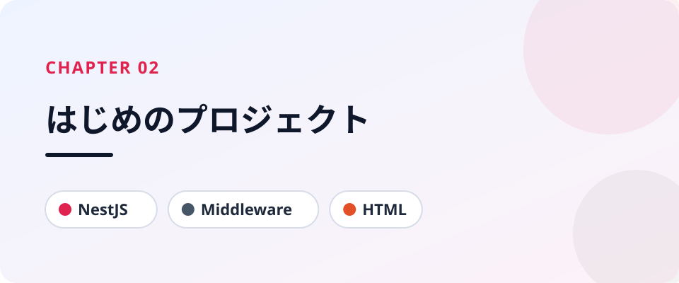

# はじめのプロジェクト



テストする題材の「はじめのプロジェクト」をダウンロードして動かし、どのファイルが何をしているかを見ます。プロジェクトは NestJS の API 1 つで、中身は次の 3 つです。

- **メモの API** … メモの一覧・作成・更新・削除。タイトルが空のような、決まりに合わない入力は断る
- **認証と認可** … トークンの無いリクエストは断る（認証）。他の人のメモは触れない。ただし `admin` グループの人は全員のメモを扱える（認可）
- **画面** … メモを追加・削除できる HTML 1 枚。API が配る

## ダウンロードして動かす

:::download
[はじめのプロジェクトをダウンロード](./project.zip)
:::

ZIP を展開してできる `02-starter-01-starter-project/` を、`notes-app/` のような名前に変えて好きな場所に置きます。このフォルダに、節ごとにテストを足していきます。

フォルダを VS Code で開き、ターミナルで `api/` に入って、ライブラリを入れてから起動します。

```bash
cd api
npm install
npm start
```

```text
[Nest] 12345  - WARN [TokenVerifier] COGNITO_USER_POOL_ID・COGNITO_CLIENT_ID が無いので、トークンはすべて 401 にします
...
[Nest] 12345  - LOG [NestApplication] Nest application successfully started
```

もう 1 つターミナルを開いて（VS Code のターミナルの右上の **＋**）、API を呼んでみます。

```bash
curl -i http://localhost:3000/notes
```

```text
HTTP/1.1 401 Unauthorized
...
{"message":"Missing bearer token","error":"Unauthorized","statusCode":401}
```

それらしいトークンを付けても、`401` のままです。

```bash
curl -i -H "Authorization: Bearer alice-token" http://localhost:3000/notes
```

```text
HTTP/1.1 401 Unauthorized
...
{"message":"Invalid token","error":"Unauthorized","statusCode":401}
```

これで正しく動いています。このプロジェクトはトークンを **Amazon Cognito** で検証する作りで、Cognito の設定が無いときは、どのトークンも断ります（起動のログの `WARN`）。ブラウザで <http://localhost:3000> を開いても、同じ理由でメモは追加できません。

:::notice
**このハンズオンでは、Cognito（AWS のアカウント）は要りません。** テストでは、トークンの検証を「`alice-token` を送ったら alice とみなす」偽物に差し替えて動かします（04 章・05 章）。

API を止めるときは、`npm start` のターミナルで `Ctrl + C` を押します。
:::

## リクエストの流れ

画面からメモを追加すると、リクエストは次の順に API の部品を通ります。


1. **AuthGuard**（Guard）… `Authorization: Bearer <トークン>` のトークンを `TokenVerifier` に確かめてもらい、正しければユーザーをリクエストに入れて通します。正しくなければ `401`
2. **Pipe** … 送られてきた値を、Zod で書いた決まり（スキーマ）で確かめます。合わなければ `400`
3. **NotesController**（コントローラー）… URL（`POST /notes` など）と処理を結びつけ、`NotesService` を呼びます
4. **NotesService**（サービス）… メモを持ち、追加・検索・更新・削除をします。他の人のメモなら `403`、無ければ `404`。`admin` グループの人には全員のメモを見せます

部品が分かれているので、テストでも「Guard だけ」「サービスだけ」を取り出して確かめられます（03 章）。

## ファイルの役割

中身は、ページの最後の「この節を終えたときのディレクトリ」で開いて読めます。

| ファイル | 役割 |
|---|---|
| `src/main.ts` | 起動する。`public/` を配る設定と、入力チェックの Pipe をアプリ全体に掛ける設定がある |
| `src/app.module.ts` | アプリ全体のモジュール |
| `src/notes/notes.controller.ts` | メモの API の URL。`@UseGuards(AuthGuard)` で、どの API もトークンが要る |
| `src/notes/notes.service.ts` | メモを持つ（メモリ上。API を止めると消える）。持ち主と `admin` の判定（認可）もここ |
| `src/notes/dto/*.dto.ts` | 作成・更新で受け取る値の決まり（Zod のスキーマ） |
| `src/auth/auth.guard.ts` | トークンを確かめる Guard |
| `src/auth/token-verifier.ts` | トークンを検証する。本物は Cognito のトークンを確かめる |
| `src/auth/bearer-token.ts` | `Authorization` ヘッダーからトークンを取り出す関数 |
| `src/auth/user.ts` | ユーザーの形（`sub` と `groups`）と、`admin` かどうかを決める関数 |
| `src/notes/notes.service.spec.ts` | `nest g resource` が作った見本のテスト（03 章で書き足す） |
| `public/index.html` | 画面。トークンを `sessionStorage` から読んで API に送る |
| `vitest.config.ts` | テストの道具 Vitest の設定 |

`nest new` が作る `app.controller.ts` と `test/` は消してあります（`test/` は 04 章で作り直します）。

## TokenVerifier を差し替えてテストする

トークンの検証は `TokenVerifier` というクラスにまとめてあります。`TokenVerifier` は環境変数 `COGNITO_USER_POOL_ID`・`COGNITO_CLIENT_ID` を読み、無ければどのトークンも `401` にします。

テストでは、この `TokenVerifier` だけを偽物に差し替えます。Guard やサービスはそのまま使うので、「トークンが無ければ 401」「他の人のメモは 403」といった決まりを、Cognito 無しで確かめられます。トークンの検証をクラスに切り出してあるのは、このためです。

## テストを動かす

API を止めてから（`Ctrl + C`）、`api/` で実行します。

```bash
npm test
```

```text
 Test Files  1 passed (1)
      Tests  1 passed (1)
```

`NotesService` が作れることを確かめるだけのテストです。次の章から、ここにテストを書き足していきます。

## 参考にした公式ドキュメント

この節は、次の公式ドキュメントをもとに書いています。

- [NestJS: Model-View-Controller](https://docs.nestjs.com/http/mvc) … `useStaticAssets()` で `public/` を配る
- [NestJS: Validation](https://docs.nestjs.com/application/validation) … `StandardSchemaValidationPipe` と `@Body({ schema })`
- [NestJS: Guards](https://docs.nestjs.com/guards) … Guard の `canActivate()` と `@UseGuards()`、リクエストの処理の順番

## この節を終えたときのディレクトリ

::tree

:::download
[この節を終えた状態をダウンロード](./project.zip)
:::

:::faq

### `EADDRINUSE: address already in use :::3000` と出る

3000 番を、ほかのプログラムが使っています。前に起動した API が残っていないか確かめてください。

### `npm install` で `npm warn` や `vulnerabilities` と出る

ライブラリについてのお知らせで、エラーではありません。そのまま進めてかまいません。

:::
