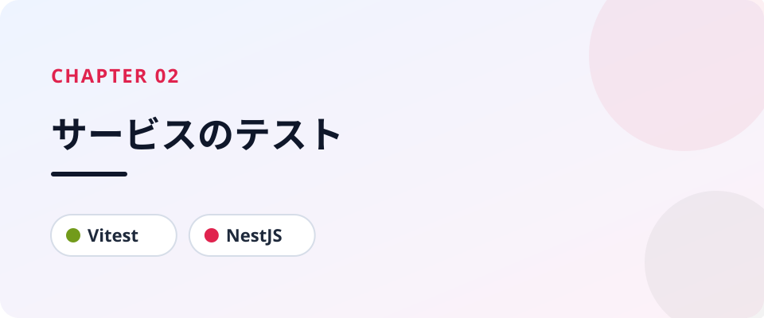
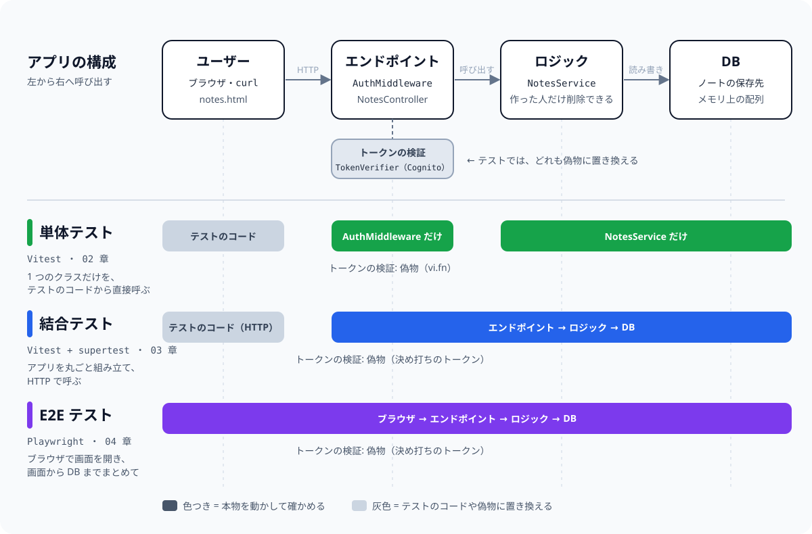

# サービスのテスト



テストには、確かめる範囲によって 3 つの種類があります。



| 種類 | 確かめる範囲 | 道具 | 章 |
|---|---|---|---|
| 単体テスト | 1 つのクラス・関数 | Vitest | 02 章 |
| 結合テスト | API 全体（HTTP で呼ぶ） | Vitest ＋ supertest | 03 章 |
| E2E テスト | 画面から API まで | Playwright | 04 章 |

範囲が狭いテストほど速く、こわれた場所をすぐ特定できます。範囲が広いテストほど、利用者が使うときに近い形で確かめられます。

この章では **単体テスト** を書きます。この節では、ノートを持ち、作った人かを確かめる `NotesService` から始めます。

## Vitest を入れる

テストの道具には **Vitest** を使います。`api/` で入れます。

```bash
npm install -D vitest
```

単体テストのファイルは、確かめるファイルの隣に `<名前>.spec.ts` の名前で置きます。Vitest が見る場所を `src/` の下の `*.spec.ts` に決めておきます。

::diff{file="api/vitest.config.ts"}

`npm test` で Vitest が動くようにします。

::diff{file="api/package.json" base="generated"}

## サービスのテストを書く

::diff{file="api/src/notes/notes.service.spec.ts"}

- `describe('NotesService', ...)` … テストをまとめる箱です
- `it('...', () => { ... })` … テスト 1 つです。名前には「どうなるべきか」を書きます。テストが落ちたとき、この名前が表示されます
- `beforeEach(...)` … 各テストの前に動きます。`NotesService` を作り直すので、どのテストもノートが空の状態から始まります
- `expect(値)` … 値が期待どおりかを確かめます。`toMatchObject()` は書いた項目だけを（`id` は毎回変わるので書かない）、`toEqual()` は中身全体を、`toHaveLength()` は配列の長さを確かめます
- `expect(() => 呼び出し).toThrow(ForbiddenException)` … 呼んだら、その種類の例外が投げられることを確かめます。`expect()` には呼び出しの **結果** ではなく **呼び出す関数**（`() => ...`）を渡します。結果を渡すと、`expect()` に届く前に例外が投げられてテストが落ちます

1 つのテストは「用意する → 実行する → 確かめる」の順で書きます。「ほかの人のノートは削除できない」のような決まりは、まちがえると困るので、単体テストで確かめておきます。

## 動かす

```bash
npm test
```

```text
 ✓ src/notes/notes.service.spec.ts (4 tests) 3ms

 Test Files  1 passed (1)
      Tests  4 passed (4)
```

試しに、`src/notes/notes.service.ts` の `remove()` の `if (this.notes[index].ownerId !== userId)` を `if (false)` に変えて `npm test` を動かすと、403 のテストが落ち、どの決まりが破れたかがテストの名前で分かります（確かめたら戻してください）。

```text
 FAIL  src/notes/notes.service.spec.ts > NotesService > ほかの人のノートは削除できない（403）
AssertionError: expected function to throw an error, but it didn't
```

## 参考にした公式ドキュメント

この節は、次の公式ドキュメントをもとに書いています。

- [NestJS: Testing](https://docs.nestjs.com/fundamentals/testing) … テストのファイルの置き場所（クラスの隣に `.spec`）
- [Vitest: Getting Started](https://vitest.dev/guide/) … 入れ方と `describe`・`it`・`expect`、`vitest` のコマンド
- [Vitest: expect](https://vitest.dev/api/expect) … `toMatchObject`・`toEqual`・`toHaveLength`・`toThrow`

## この節を終えたときのディレクトリ

::tree

:::download
[この節を終えた状態をダウンロード](./project.zip)
:::
