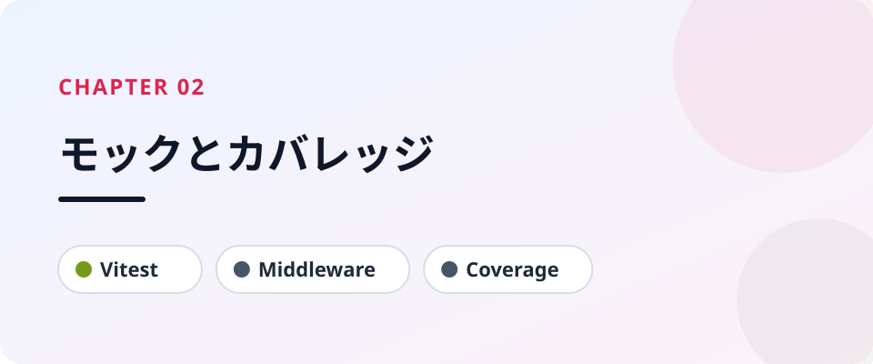

# モックとカバレッジ



この節では、ほかの部品に頼っている `AuthMiddleware` を、頼っている相手を **偽物（モック）** に差し替えて確かめます。最後に、テストがコードのどこを通ったかを **カバレッジ** で見ます。

## 偽物（モック）で切り離す

`AuthMiddleware` は、トークンの検証を `TokenVerifier` に任せていて、`TokenVerifier` は Cognito を見に行きます。そのままでは、Cognito が無いこの環境ではどのトークンも `401` になり、「正しいトークンなら通す」を確かめられません。

単体テストでは、確かめたいクラスの **相手を偽物に差し替えて** 切り離します。偽物は「こう呼ばれたら、こう返す」をテストの中で決められ、どう呼ばれたかも記録します。

::diff{file="api/src/auth/auth.middleware.spec.ts"}

- `vi.fn<TokenVerifier['verify']>()` … 偽物の関数を作ります。`vi` は Vitest の道具箱です
- `new AuthMiddleware({ verify } as unknown as TokenVerifier)` … DI を使わず `new` で作り、`verify` だけを持つ偽物を `TokenVerifier` として渡します。`as unknown as` は、一部しか持たない偽物を型の上で `TokenVerifier` として扱うための書き方です
- `verify.mockResolvedValue({ sub: 'alice' })` … 呼ばれたら alice を返す（`Promise` で）ように決めます。`mockRejectedValue()` は失敗させます
- `next` … middleware が「先に進める」ときに呼ぶ関数です。これも偽物にして、呼ばれたかを `toHaveBeenCalled()` / `not.toHaveBeenCalled()` で確かめます
- `expect(verify).toHaveBeenCalledWith('Bearer good')` … 偽物が、この引数で呼ばれたかを確かめます
- `beforeEach(...)` … テストごとに、偽物の記録と決めごとを `mockReset()` で消します
- `requestWith()` … middleware が使う `headers.authorization` だけを持つ、リクエストのまねです

`use()` は `async` なので、`await expect(...).rejects.toThrow(...)` で確かめます。`await` を忘れると、確かめる前にテストが終わってしまいます。

```bash
npm test
```

```text
 Test Files  2 passed (2)
      Tests  6 passed (6)
```

:::notice
偽物で確かめられるのは、「`TokenVerifier` がこう答えたら、`AuthMiddleware` はこうする」までです。`TokenVerifier` が本物の Cognito のトークンを正しく検証できるかは、このテストでは分かりません。このハンズオンでは、本物の Cognito での確かめは扱いません。
:::

## カバレッジを見る

テストがコードのどこを通ったかの割合を、**カバレッジ** と呼びます。カバレッジを測る道具を入れます。

```bash
npm install -D @vitest/coverage-v8
```

`npm run test:cov` で測れるようにし、結果を書き出す `coverage/` を Git に入れないようにします。

::diff{file="api/package.json" base="generated"}

::diff{file="api/.gitignore"}

```bash
npm run test:cov
```

```text
-------------------|---------|----------|---------|---------|-------------------
File               | % Stmts | % Branch | % Funcs | % Lines | Uncovered Line #s
-------------------|---------|----------|---------|---------|-------------------
All files          |    52.5 |       25 |      60 |   52.63 |
 auth              |   26.92 |     6.25 |   33.33 |      28 |
  ...middleware.ts |     100 |       50 |     100 |     100 | 12
  ...n-verifier.ts |    9.52 |        0 |       0 |      10 | 14-26,35-56
 notes             |     100 |      100 |     100 |     100 |
  notes.service.ts |     100 |      100 |     100 |     100 |
-------------------|---------|----------|---------|---------|-------------------
```

`% Branch` は `if` などの分かれ道のうち通った割合、`Uncovered Line #s` は通らなかった行です。表から、次のことが読み取れます。

- `notes.service.ts` … すべての行と分かれ道を通っています
- `token-verifier.ts` … Cognito と話す部分で、テストでは偽物に差し替えるので通りません
- `auth.middleware.ts` の 12 行目 … `@Injectable()` の行です。TypeScript がデコレーターのために足したコードの分かれ道で、テストで通すものではありません
- 表に出ていないファイル（`notes.controller.ts`・`app.module.ts`）… テストから一度も読み込まれていません。「どの URL に middleware が掛かるか」のような組み合わせは、次の章の **結合テスト** で、HTTP で呼んで確かめます

カバレッジは「テストが足りない場所を探す」ための目安です。100% を目指すより、まちがえると困るところ（作った人だけが削除できる判定など）を確かめることを大事にします。

## 参考にした公式ドキュメント

この節は、次の公式ドキュメントをもとに書いています。

- [Vitest: Mocking](https://vitest.dev/guide/mocking) … `vi.fn()` で偽物を作る
- [Vitest: Mock Functions](https://vitest.dev/api/mock) … `mockResolvedValue()`・`mockRejectedValue()`・`mockReset()`
- [Vitest: expect](https://vitest.dev/api/expect) … `toHaveBeenCalled()`・`toHaveBeenCalledWith()`、`rejects`
- [Vitest: Coverage](https://vitest.dev/guide/coverage) … `@vitest/coverage-v8` と `--coverage`
- [Vitest: coverage の設定](https://vitest.dev/config/coverage) … 読み込まれたファイルだけが表に出る（`coverage.include` の既定）

## この節を終えたときのディレクトリ

::tree

:::download
[この節を終えた状態をダウンロード](./project.zip)
:::
