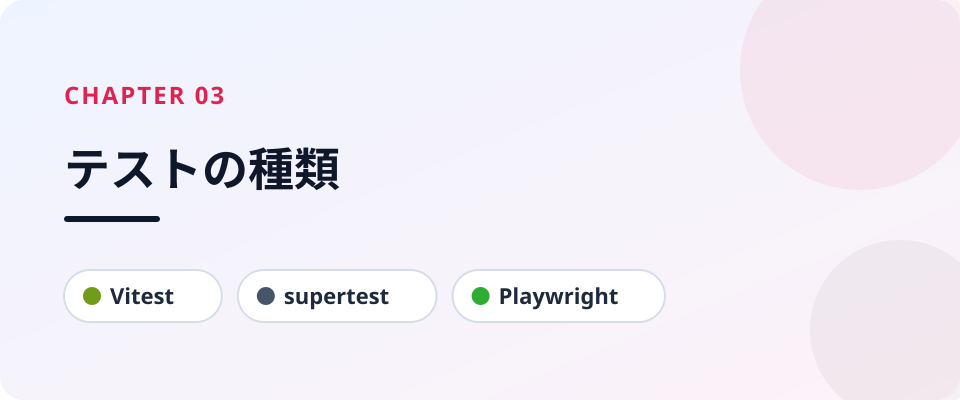
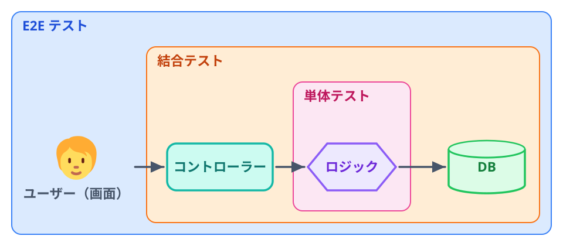

# テストの種類

この章では、コードは書きません。これから書く 3 つのテストが、アプリのどこからどこまでを確かめるかを見ます。

## 確かめる範囲

割り勘のアプリは、ユーザー（画面）・コントローラー・ロジック・DB の 4 つでできています。テストには、このうちのどこまでを動かして確かめるかによって、3 つの種類があります。

| 種類 | 確かめる範囲 | 道具 | 章 |
|---|---|---|---|
| 単体テスト | ロジック（1 つの関数・クラス）だけ。07 章では、DI コンテナでサービスに切り出し、アプリも DB も起動せずに確かめる | Vitest | 04 章・07 章 |
| 結合テスト | コントローラーから DB まで（HTTP で呼ぶ） | Vitest ＋ supertest | 05 章 |
| E2E テスト | ユーザー（画面）から DB まで（ブラウザで操作する） | Playwright | 06 章 |

## 範囲の広さのちがい

範囲が狭いテストほど速く、こわれた場所をすぐ特定できます。範囲が広いテストほど、使う人が使うときに近い形で確かめられる代わりに、動かすのに時間がかかります。

そのため、細かい決まり（端数の 1 円をだれに付けるか、など）は単体テストで数多く確かめ、つないでみないと分からないこと（DB に正しく書けるか、画面に清算が出るか）だけを、結合テストと E2E テストで確かめます。

## 参考にした公式ドキュメント

この節は、次の公式ドキュメントをもとに書いています。

- [NestJS: Testing](https://docs.nestjs.com/fundamentals/testing) … 単体テストと、アプリを組み立てて HTTP で呼ぶテスト
- [Playwright: Installation](https://playwright.dev/docs/intro) … ブラウザを動かすテスト
