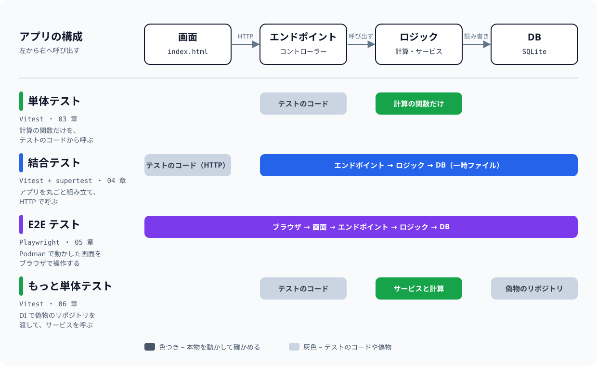
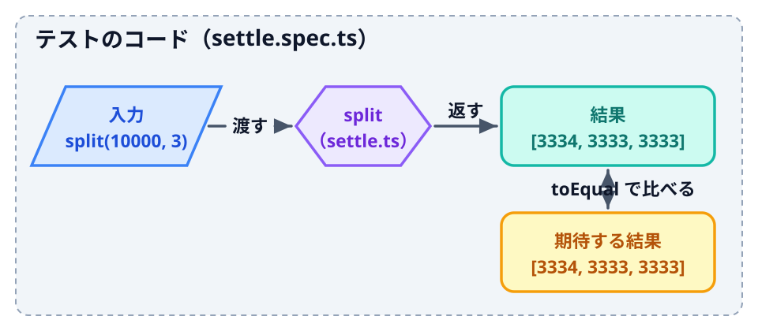
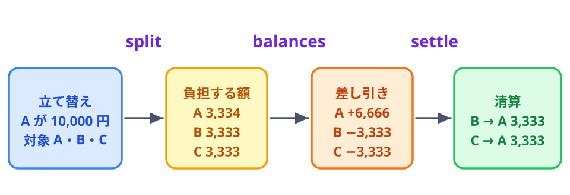

# 単体テストの設計

この節では、コードはまだ書きません。何をどう確かめるかを、表にして決めます。

## テストの 3 つの種類

テストには、確かめる範囲によって 3 つの種類があります。

| 種類 | 確かめる範囲 | 道具 | 章 |
|---|---|---|---|
| 単体テスト | ロジック（1 つの関数・クラス）だけ | Vitest | 03 章・06 章 |
| 結合テスト | コントローラーから DB まで（HTTP で呼ぶ） | Vitest ＋ supertest | 04 章 |
| E2E テスト | ユーザー（画面）から DB まで（ブラウザで操作する） | Playwright | 05 章 |

範囲が狭いテストほど速く、こわれた場所をすぐ特定できます。範囲が広いテストほど、利用者が使うときに近い形で確かめられます。

## 何を単体テストするか

この章では、清算の計算（`src/settlement/settle.ts`）の `split`・`balances`・`settle` を単体テストします。この 3 つは DB も HTTP も使わず、同じ入力には必ず同じ結果を返す関数です。そのため、テストのコードから直接呼んで、返ってきた結果を確かめられます。

3 つの関数は、次のように金額を受け渡します。

## テストケースを設計する

関数ごとに「入力 → 期待する結果」を表にします。まずふつうの場合を 1 つ置き、そのあとに、まちがえやすい端数と境界を足していきます。

### `split(amount, count)`

| 番号 | 観点 | 入力 | 期待する結果 |
|---|---|---|---|
| S1 | ふつう（割り切れる） | `split(9000, 3)` | `[3000, 3000, 3000]` |
| S2 | 端数（余った 1 円をだれに付けるか） | `split(10000, 3)` | `[3334, 3333, 3333]`（合計は 10000） |
| S3 | 境界（0 円） | `split(0, 3)` | `[0, 0, 0]` |
| S4 | 境界（1 人） | `split(500, 1)` | `[500]` |

### `balances(payments)`

| 番号 | 観点 | 入力 | 期待する結果 |
|---|---|---|---|
| B1 | ふつう | 1 が 9,000 円を払い、対象は 1・2・3 | 1 は `+6000`、2・3 は `-3000` |
| B2 | 払った人が対象でない | 1 が 6,000 円を払い、対象は 2・3 | 1 は `+6000`、2・3 は `-3000` |
| B3 | どの立て替えにも出てこない人 | 1 が 1,000 円を払い、対象は 1・2 | 1・2 だけが入る |

### `settle(balances)`

| 番号 | 観点 | 入力 | 期待する結果 |
|---|---|---|---|
| T1 | ふつう（受け取る人が 1 人） | 1 が `+6000`、2・3 が `-3000` | 2 → 1 に 3,000、3 → 1 に 3,000 |
| T2 | 組み合わせ（受け取る人が 2 人） | 1 が `+5000`、2 が `+1000`、3 が `-6000` | 3 → 1 に 5,000、3 → 2 に 1,000 |
| T3 | 境界（差し引きが 0 の人だけ） | 1 が `0` | 払う人はいない（空） |

次の節で、ふつうの場合（S1・B1）をテストに書きます。残りは、その次の節で足します。

## 参考にした公式ドキュメント

この節は、次の公式ドキュメントをもとに書いています。

- [Vitest: Getting Started](https://vitest.dev/guide/) … Vitest で関数を呼んで結果を確かめるテスト
