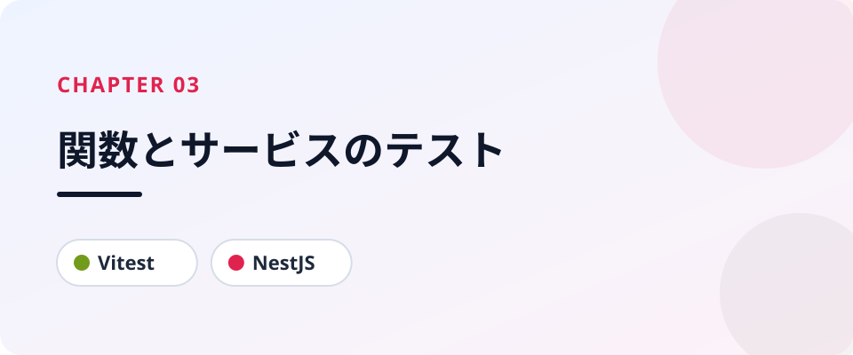

# 関数とサービスのテスト



テストには、確かめる範囲によって 3 つの種類があります。


| 種類 | 確かめる範囲 | 道具 | 速さ | 章 |
|---|---|---|---|---|
| 単体テスト | 1 つのクラス・関数 | Vitest | とても速い | 03 章 |
| 結合テスト | API 全体（HTTP で呼ぶ） | Vitest ＋ supertest | 速い | 04 章 |
| E2E テスト | 画面から API まで | Playwright | 遅い | 05 章 |

範囲が狭いテストほど、速く動き、こわれた場所をすぐ特定できます。範囲が広いテストほど、利用者が使うときに近い形で確かめられます。たくさんの単体テストと、要所を押さえた結合テスト・E2E テストを組み合わせるのが基本です。

この章では **単体テスト** を書きます。この節では、いちばん書きやすい「関数」と「サービス」から始めます。

:::notice
テストの道具には **Vitest** を使います。`nest new`（NestJS 12）が最初から入れている道具で、はじめのプロジェクトの `notes.service.spec.ts` もすでに Vitest で動いています。書き方（`describe`・`it`・`expect`）は Jest とほぼ同じです。違いは次の節の「よくある質問」にまとめました。
:::

## テストを動かす

`api/` で `npm test` を実行すると、`*.spec.ts` のファイルがすべて動きます。

```bash
cd api
npm test
```

```text
 Test Files  1 passed (1)
      Tests  1 passed (1)
```

`npm run test:watch` にすると、ファイルを保存するたびに、関係するテストだけが動き直します。テストを書いている間は、こちらが便利です（止めるときは `q`）。

テストのファイルは、確かめるファイルの隣に `<名前>.spec.ts` の名前で置きます。`nest g` もこの形で作ります。

## 関数のテスト

まずは、いちばん簡単な「引数を渡すと値が返る」関数から始めます。ユーザーが `admin` グループに入っているかを決める `isAdmin()`（`src/auth/user.ts`）です。

::diff{file="api/src/auth/user.spec.ts"}

- `describe('isAdmin', ...)` … テストをまとめる箱です。何のテストかを書きます
- `it('...', () => { ... })` … テスト 1 つです。名前には「どうなるべきか」を書きます。テストが落ちたとき、この名前が表示されます
- `expect(値).toBe(期待する値)` … 値が期待どおりかを確かめます。違えばテストが落ちます

1 つのテストは「用意する → 実行する → 確かめる」の順で書きます。ここでは、ユーザーを用意し、`isAdmin()` を呼び、`true` か `false` かを確かめています。

`describe`・`it`・`expect` を import していないのは、`vitest.config.ts` の `globals: true` で、どのテストのファイルからも使えるようにしてあるからです。

## 例外を投げる関数のテスト

`Authorization` ヘッダーからトークンを取り出す `extractBearerToken()`（`src/auth/bearer-token.ts`）は、形が違うと例外を投げます。例外も「期待どおりの結果」の 1 つとして確かめます。

::diff{file="api/src/auth/bearer-token.spec.ts"}

- `expect(() => 呼び出し).toThrow(UnauthorizedException)` … 呼んだら、その種類の例外が投げられることを確かめます
- `toThrow('Missing bearer token')` … 例外のメッセージで確かめることもできます

`expect()` には、呼び出しの **結果** ではなく、**呼び出す関数**（`() => ...`）を渡します。`expect(extractBearerToken(undefined))` と書くと、`expect()` に届く前に例外が投げられて、テストがそこで落ちてしまいます。

## サービスのテスト

次は、メモを持ち、持ち主を確かめる `NotesService` です。`nest g resource` が作った「`should be defined`」のテストに書き足します。

::diff{file="api/src/notes/notes.service.spec.ts"}

- `Test.createTestingModule({ providers: [NotesService] })` … NestJS の DI（依存性の注入）の仕組みで `NotesService` を作ります。`nest g` が作ったままの書き方です
- `beforeEach(...)` … 各テストの前に動きます。テストごとに `NotesService` を作り直すので、どのテストもメモが空の状態から始まります。前のテストで作ったメモに、次のテストが左右されません
- `toMatchObject({...})` … 書いた項目だけを確かめます。`id` や `createdAt` は毎回変わるので、確かめたい項目だけを書きます
- `toHaveLength(2)` … 配列の長さを確かめます

テストの名前を「どうなるべきか」で書いておくと、そのまま **サービスの決まりの一覧** になります。「他の人のメモは読めない・書き換えられない・消せない」「admin は他の人のメモも書き換えられる」のような認可の決まりは、まちがえると困るので、単体テストでこまかく確かめておきます。

## 動かす

```bash
npm test
```

```text
 Test Files  3 passed (3)
      Tests  14 passed (14)
```

試しに、`src/notes/notes.service.ts` の `findOne()` の `&& !isAdmin(user)` を消してから `npm test` を動かしてみてください。admin のテストが落ち、どの決まりが破れたかがテストの名前で分かります（確かめたら戻してください）。

```text
 FAIL  src/notes/notes.service.spec.ts > NotesService > admin は他の人のメモも書き換えられる
ForbiddenException: Note 7f6c... is not yours
```

## 参考にした公式ドキュメント

この節は、次の公式ドキュメントをもとに書いています。

- [NestJS: Testing](https://docs.nestjs.com/fundamentals/testing) … テストのファイルの置き場所（クラスの隣に `.spec`）と `Test.createTestingModule()`
- [Vitest: Getting Started](https://vitest.dev/guide/) … `describe`・`it`・`expect` と `vitest` のコマンド
- [Vitest: expect](https://vitest.dev/api/expect) … `toBe`・`toThrow`・`toMatchObject`・`toHaveLength`
- [Vitest: globals](https://vitest.dev/config/globals) … `globals: true` と、型のための `vitest/globals`

## この節を終えたときのディレクトリ

::tree

:::download
[この節を終えた状態をダウンロード](./project.zip)
:::

:::faq

### テストを 1 つだけ動かしたい

`npm test -- bearer-token` のように、ファイル名の一部を渡します。テストの中で `it.only(...)` と書くと、そのテストだけが動きます（終わったら戻してください）。

### `Test.createTestingModule()` で作るのと、`new NotesService()` で作るのはどう違う？

`NotesService` は何も受け取らないので、`new NotesService()` でも同じテストが書けます。`Test.createTestingModule()` は、NestJS の DI を使ってクラスを作ります。依存がたくさんあるときや、モジュールの組み立てまで確かめたいときに役立ちます。依存が少なければ `new` で作るほうが、何を渡しているかが見えて分かりやすくなります（次の節の Guard は `new` で作ります）。

### Zod のスキーマもテストできる？

できます。`createNoteSchema.safeParse({ title: '' }).success` が `false` になることを確かめる、といった書き方です。このハンズオンでは、入力チェックは 04 章の結合テストで、HTTP で呼んで確かめます。

:::
