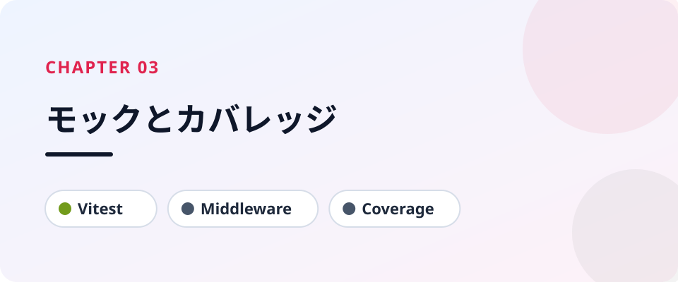

# モックとカバレッジ



この節では、ほかの部品に頼っている `AuthGuard` を、頼っている相手を **偽物（モック）** に差し替えて確かめます。最後に、テストがコードのどこを通ったかを **カバレッジ** で見ます。

## 偽物（モック）で切り離す

`AuthGuard` は、トークンの検証を `TokenVerifier` に任せていて、`TokenVerifier` は Cognito を見に行きます。そのままでは、Cognito が無いこの環境ではどのトークンも `401` になり、「正しいトークンなら通す」を確かめられません。

単体テストでは、確かめたいクラスの **相手を偽物に差し替えて** 切り離します。偽物は「こう呼ばれたら、こう返す」をテストの中で決められ、どう呼ばれたかも記録します。

::diff{file="api/src/auth/auth.guard.spec.ts"}

- `vi.fn<TokenVerifier['verify']>()` … 偽物の関数を作ります。`vi` は Vitest の道具箱です（import しなくても使えます）
- `new AuthGuard({ verify } as unknown as TokenVerifier)` … DI を使わず `new` で作り、`verify` だけを持つ偽物を `TokenVerifier` として渡します。`as unknown as` は、一部しか持たない偽物を型の上で `TokenVerifier` として扱うための書き方です
- `verify.mockResolvedValue(alice)` … 呼ばれたら `alice` を返す（`Promise` で）ように決めます。`mockRejectedValue()` は失敗させます
- `expect(verify).toHaveBeenCalledWith('Bearer good')` … 偽物が、この引数で呼ばれたかを確かめます
- `beforeEach(() => verify.mockReset())` … テストごとに、偽物の記録と決めごとを消します
- `contextFor()` … Guard が受け取る `ExecutionContext` のまねです。`AuthGuard` が使う `switchToHttp().getRequest()` だけを用意しています

`canActivate()` は `async` なので、`await expect(...).resolves.toBe(true)` / `await expect(...).rejects.toThrow(...)` で確かめます。`await` を忘れると、確かめる前にテストが終わってしまいます。

```bash
npm test
```

```text
 Test Files  4 passed (4)
      Tests  16 passed (16)
```

:::notice
偽物で確かめられるのは、「`TokenVerifier` がこう答えたら、`AuthGuard` はこうする」までです。`TokenVerifier` が本物の Cognito のトークンを正しく検証できるかは、このテストでは分かりません。このハンズオンでは、本物の Cognito での確かめは扱いません。
:::

## カバレッジを見る

テストがコードのどこを通ったかの割合を、**カバレッジ** と呼びます。

```bash
npm run test:cov
```

```text
-------------------|---------|----------|---------|---------|-------------------
File               | % Stmts | % Branch | % Funcs | % Lines | Uncovered Line #s
-------------------|---------|----------|---------|---------|-------------------
All files          |   70.17 |       60 |   78.57 |   70.58 |
 auth              |   46.66 |    38.88 |   57.14 |   48.27 |
  auth.guard.ts    |     100 |       50 |     100 |     100 | 13
  ...n-verifier.ts |   11.11 |        0 |       0 |   11.76 | 8-11,24-46
 notes             |   96.29 |    91.66 |     100 |     100 |
  notes.service.ts |   96.29 |    91.66 |     100 |     100 | 52
-------------------|---------|----------|---------|---------|-------------------
```

`% Branch` は `if` などの分かれ道のうち通った割合、`Uncovered Line #s` は通らなかった行です。すべて通ったファイル（`bearer-token.ts` など）は表に出ません。表から、次のことが読み取れます。

- `notes.service.ts` の 52 行目 … `update()` で本文を書き換える分かれ道を、まだ通っていません。テストが足りない、という目安になります
- `token-verifier.ts` … Cognito と話す部分で、テストでは偽物に差し替えるので通りません
- `auth.guard.ts` の 13 行目 … `@Injectable()` の行です。TypeScript がデコレーターのために足したコードの分かれ道で、テストで通すものではありません
- 表に出ていないファイル（`notes.controller.ts` など）… テストから一度も読み込まれていません。コントローラーは、次の章の **結合テスト** で HTTP で呼んで確かめます

カバレッジは「テストが足りない場所を探す」ための目安です。100% を目指すより、まちがえると困るところ（認可の判定など）を確かめることを大事にします。

## 参考にした公式ドキュメント

この節は、次の公式ドキュメントをもとに書いています。

- [Vitest: Mocking](https://vitest.dev/guide/mocking) … `vi.fn()` で偽物を作る
- [Vitest: Mock Functions](https://vitest.dev/api/mock) … `mockResolvedValue()`・`mockRejectedValue()`・`mockReset()`
- [Vitest: expect](https://vitest.dev/api/expect) … `toHaveBeenCalledWith()`、`resolves`・`rejects`
- [Vitest: Coverage](https://vitest.dev/guide/coverage) … `--coverage` と v8 のカバレッジ
- [Vitest: coverage の設定](https://vitest.dev/config/coverage) … 読み込まれたファイルだけが表に出る（`coverage.include` の既定）

## この節を終えたときのディレクトリ

::tree

:::download
[この節を終えた状態をダウンロード](./project.zip)
:::
