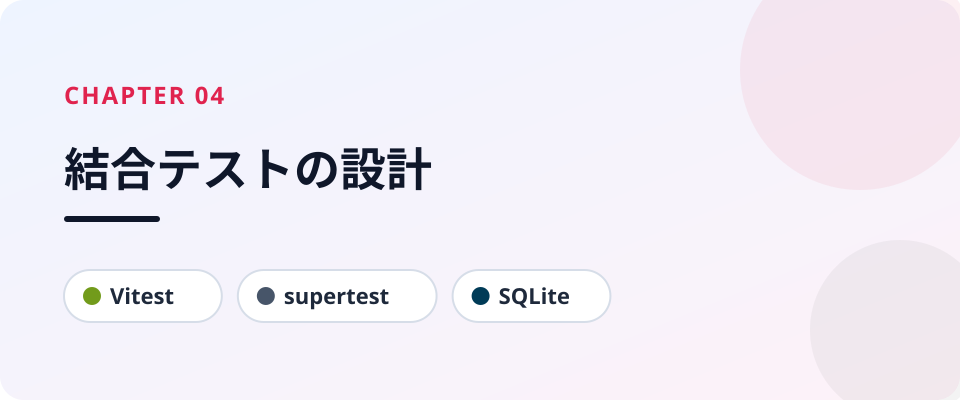
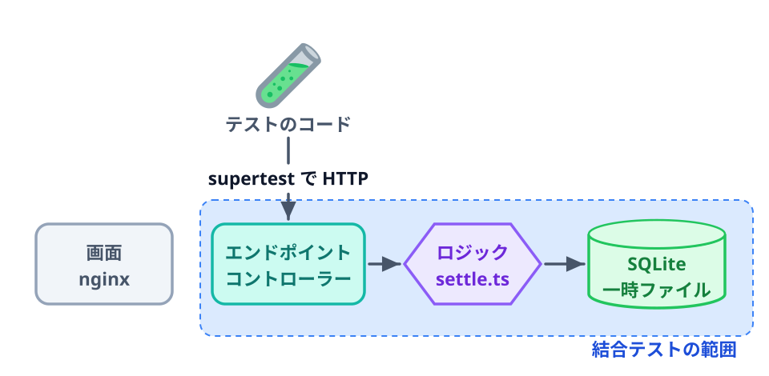

# 結合テストの設計

この節では、コードはまだ書きません。結合テストで何を確かめるかを、表にして決めます。

## 結合テストの範囲

**結合テスト** では、アプリを丸ごと組み立てて HTTP で呼び、エンドポイントからロジック・DB までをまとめて確かめます。画面は使いません。

単体テストは、関数に入力を渡して結果を比べるだけでした。結合テストでは、実際に DB まで書き込みます。そのため、次の 2 つを確かめられます。

- HTTP の応答（ステータスコードと本文）が正しい
- DB の表に、正しい行が入っている

ふだんのデータを消さないように、テストではテストごとに一時ファイルの新しい DB を使います。

## テストケースを設計する

「リクエストの並び → 期待する応答と DB の中身」を表にします。

| 番号 | リクエストの並び | 期待する応答 | 期待する DB の中身 |
|---|---|---|---|
| I1 | `POST /members` で A・B・C を足し、`POST /payments` で「1 が 10,000 円、対象は 1・2・3」を記録する | どれも `201` | `members` に 3 行、`payments` に 1 行、`payment_participants` に 3 行 |
| I2 | I1 と同じものを足したあと、`GET /settlement` | `200`、本文は「2 → 1 に 3,333」「3 → 1 に 3,333」 | （変わらない） |
| I3 | 何も足さずに `GET /settlement` | `200`、本文は空の配列 | （空のまま） |

次の節で、I1 のうち、メンバーを 1 人足すところだけをテストに書きます。残りは、その次の節で足します。

## 参考にした公式ドキュメント

この節は、次の公式ドキュメントをもとに書いています。

- [NestJS: Testing](https://docs.nestjs.com/fundamentals/testing) … アプリを組み立てて HTTP で呼ぶテスト（NestJS は e2e テストと呼ぶ）
