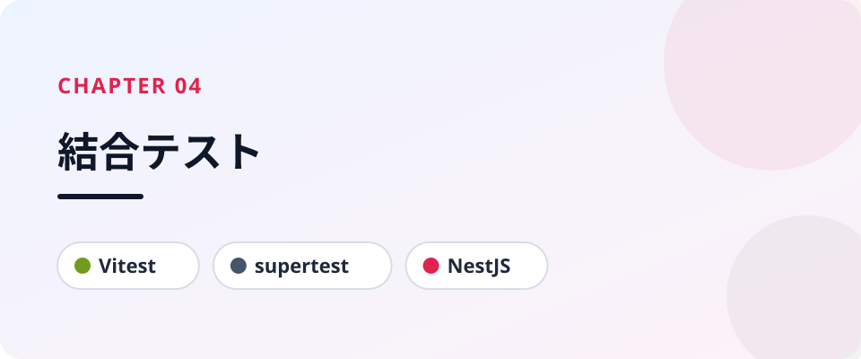

# 結合テスト



単体テストでは、部品を 1 つずつ切り離して確かめました。でも、次のことは部品を 1 つずつ見ても分かりません。

- 作成と削除に `AuthMiddleware` が掛かっていて、トークンが無ければ `401` になるか
- 一覧には掛かっておらず、トークンなしで見られるか
- コントローラーが、middleware の入れたユーザーをサービスに渡し、ほかの人のノートの削除が `403` になるか

この章では、API を丸ごと組み立てて HTTP で呼ぶ **結合テスト** を書きます。

## テストでの認証は「トークンの直書き」にする

`TokenVerifier` は Cognito を見る作りなので、この環境ではどのトークンも通りません。そこで、このハンズオンでは、テストでの認証を **トークンの直書き** にします。`alice-token` のような決め打ちの文字列をトークンとして送り、API の側では `TokenVerifier` だけを、その文字列をユーザーに対応させる偽物に差し替えます。

| 送るトークン | ユーザー |
|---|---|
| `alice-token` | `alice` |
| `bob-token` | `bob` |

:::warning
**本来は、テストの認証は別の仕組みで行います。** たとえば、テスト用のユーザーで実際にサインインする、テスト用の鍵で署名したトークンで本物の検証を通す、といったやり方です。このハンズオンでは、テストの書き方に集中するため、これらには触れません。

決め打ちのトークンでは、「Cognito が出した本物のトークンを、正しく検証できるか」は確かめられません。
:::

## 偽物の TokenVerifier

::diff{file="api/src/auth/fake-token-verifier.ts"}

- `FAKE_TOKENS` … 決め打ちのトークンと、それが表すユーザーの対応表です
- `implements Pick<TokenVerifier, 'verify'>` … 本物と同じ形の `verify()` を持つことを、TypeScript に確かめさせます
- トークンが無い・形が違うときは、本物と同じ `extractBearerToken()` で `401` にします

`test/` ではなく `src/` に置くのは、次の章の E2E テストで、起動した API からも使うためです。

## 結合テストの道具と設定

アプリを組み立てる `@nestjs/testing` と、HTTP のリクエストを送る **supertest** を入れます。

```bash
npm install -D @nestjs/testing supertest @types/supertest
```

NestJS の公式ドキュメントは、このようなテストを「e2e テスト」と呼びます。このハンズオンでは、ブラウザから画面を操作するテスト（次の章）を E2E テストと呼ぶので、こちらは **結合テスト** と呼び、`test/<名前>.integration-spec.ts` の名前で置きます。結合テスト用の Vitest の設定を作り、`npm run test:integration` で動くようにします。

::diff{file="api/vitest.config.integration.ts"}

::diff{file="api/package.json"}

`npm test`（`vitest.config.ts`）は `src/` の下だけを見るので、結合テストは入りません。速い単体テストと分けて動かせます。

## 結合テストを書く

::diff{file="api/test/notes.integration-spec.ts"}

- `Test.createTestingModule({ imports: [AppModule] })` … 本物の `AppModule` を、そのまま組み立てます。middleware を掛ける設定（`configure()`）も入ります
- `.overrideProvider(TokenVerifier).useClass(FakeTokenVerifier)` … `TokenVerifier` だけを偽物に差し替えます。middleware・コントローラー・サービスは本物のままです
- `request(app.getHttpServer())` … supertest で HTTP のリクエストを送ります。API を `npm start` で起動しておく必要はありません
- `.set(as('alice-token'))` … `Authorization: Bearer alice-token` を付けます
- `.send({...})` で本文（JSON）を送り、`.expect(201)` でステータスコードを確かめます。本文は `res.body` で受け取って確かめます
- `beforeEach` でアプリを作り直し、`afterEach` で閉じます。テストごとにノートが空の状態から始まります

## 動かす

```bash
npm run test:integration
```

```text
 ✓ test/notes.integration-spec.ts (6 tests) 81ms

 Test Files  1 passed (1)
      Tests  6 passed (6)
```

試しに、`src/app.module.ts` の `forRoutes()` から `{ path: 'notes', method: RequestMethod.POST },` の行を消して動かすと、作成に middleware が掛からなくなり、5 つのテストが落ちます。単体テストでは気づけない、組み合わせの間違いです（確かめたら戻してください）。

```text
 FAIL  test/notes.integration-spec.ts > ノートの API（結合テスト） > トークンが無ければ、作成は 401
Error: expected 401 "Unauthorized", got 500 "Internal Server Error"
```

## 参考にした公式ドキュメント

この節は、次の公式ドキュメントをもとに書いています。

- [NestJS: Testing](https://docs.nestjs.com/fundamentals/testing) … アプリを丸ごと組み立てて HTTP で呼ぶテスト（`createNestApplication()`・`app.init()`・`request(app.getHttpServer())`）と `overrideProvider()`
- [supertest（README）](https://github.com/ladjs/supertest) … `.set()`・`.send()`・`.expect()` の使い方

## この節を終えたときのディレクトリ

::tree

:::download
[この節を終えた状態をダウンロード](./project.zip)
:::
