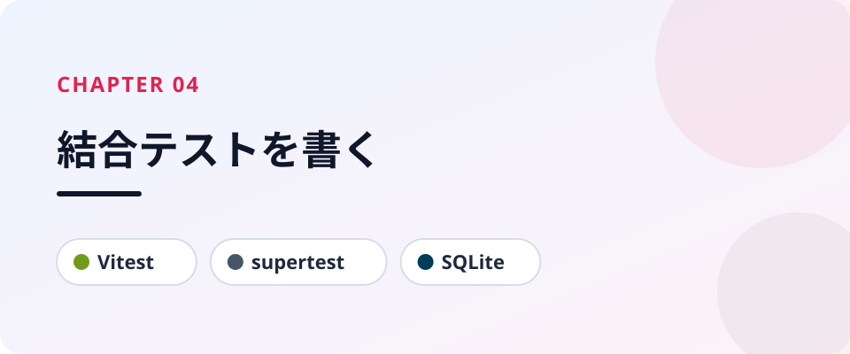

# 結合テストを書く



前の節で設計した I1 のうち、まず「`POST /members` で `201` が返り、`members` の表に 1 行入る」ところだけをテストに書いて動かします。

## 結合テストの置き場所を確かめる

アプリをテストの中で組み立てる `@nestjs/testing` と、HTTP で呼ぶ **supertest** も、`nest new` がはじめから入れています。結合テストを動かす設定もあります。

| ファイル | 中身 |
|---|---|
| `package.json` | `devDependencies` に `@nestjs/testing`・`supertest`。`scripts` の `test:e2e` は `vitest run --config ./vitest.config.e2e.ts` |
| `vitest.config.e2e.ts` | `include: ['**/*.e2e-spec.ts']`。名前が `.e2e-spec.ts` で終わるファイルを動かす |

NestJS は、アプリを組み立てて HTTP で呼ぶテストを「e2e テスト」と呼び、`test/` に `.e2e-spec.ts` の名前で置きます。このハンズオンでは、ブラウザで画面を操作するテスト（05 章）を E2E テストと呼ぶので、こちらを **結合テスト** と呼びます。ファイルの名前と置き場所、コマンドは、`nest new` が用意したものをそのまま使います。

`npm test`（`vitest.config.ts`）が見るのは `.spec.ts` だけなので、結合テストは入りません。速い単体テストと分けて動かせます。

## テストを書く

::diff{file="api/test/settlement.e2e-spec.ts"}

- `process.env.DB_PATH = dbPath` … コントローラーは `openDatabase()` で、`DB_PATH` のファイルを開きます。アプリを組み立てる前に、一時フォルダ（`tmpdir()`）の新しいファイルを指しておきます。テストが終わったら `rmSync()` で消します
- `beforeEach()`・`afterEach()` … テスト 1 つごとに、前と後に動かす処理です。テストごとに新しい DB とアプリを用意し、テストどうしが影響し合わないようにします
- `Test.createTestingModule({ imports: [AppModule] })` … テストの中で、アプリと同じモジュールを組み立てます。`createNestApplication()` と `init()` で、ポートを開かずに HTTP を受けられる状態にします
- `request(app.getHttpServer()).post('/members').send({ name: 'A' })` … supertest で HTTP を送ります。`.expect(201)` でステータスコードを確かめます
- `new DatabaseSync(dbPath)` … API を通さずにファイルを直接開き、表に入ったものを SQL で読んで確かめます

## 動かす

```bash
npm run test:e2e
```

```text
 ✓ test/settlement.e2e-spec.ts (1 test) 58ms

 Test Files  1 passed (1)
      Tests  1 passed (1)
```

## 参考にした公式ドキュメント

この節は、次の公式ドキュメントをもとに書いています。

- [NestJS: Testing](https://docs.nestjs.com/fundamentals/testing) … `Test.createTestingModule()` と、supertest で HTTP を送るテスト。`test/` の `.e2e-spec.ts`
- [Vitest: Hooks](https://vitest.dev/api/hooks) … `beforeEach`・`afterEach`
- [Node.js: os.tmpdir()](https://nodejs.org/docs/latest-v26.x/api/os.html#ostmpdir) … 一時フォルダの場所
- [Node.js: SQLite](https://nodejs.org/docs/latest-v26.x/api/sqlite.html) … `DatabaseSync` と `prepare().all()`

## この節を終えたときのディレクトリ

::tree

:::download
[この節を終えた状態をダウンロード](./project.zip)
:::
