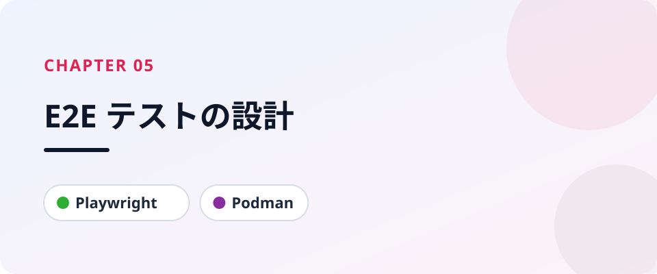
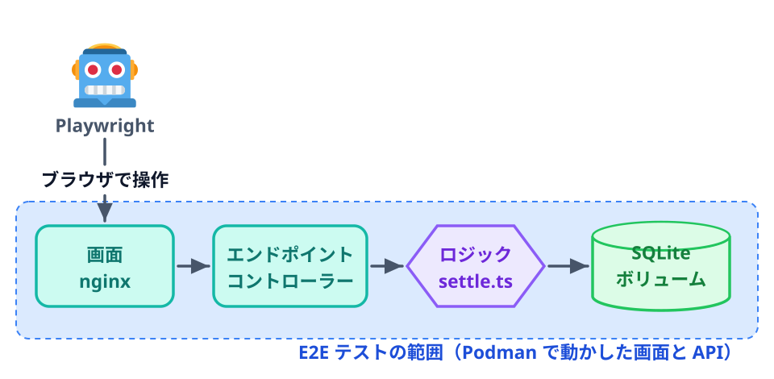

# E2E テストの設計

この節では、コードはまだ書きません。E2E テストで確かめるユースケースと、画面でする操作を表にして決めます。

## E2E テストの範囲

**E2E テスト** では、Playwright がブラウザを動かし、Podman で動かした画面と API に対して、利用者と同じように画面を操作します。画面（nginx）から API・DB までのすべてが範囲です。

結合テストは、テストのコードから HTTP で API を呼びました。E2E テストは、画面のボタンを押し、画面に出た文字を確かめます。画面の HTML や `fetch` のまちがいも見つけられる代わりに、Podman で全体を動かす必要があり、結合テストより遅くなります。そのため、E2E テストは、いちばん大事なユースケースに絞って書きます。

## ユースケースを決める

このアプリでいちばん大事なのは、割り勘の結果が画面に出ることです。次のユースケースを確かめます。

> 3 人の飲み会で A が 10,000 円を立て替えた。画面でメンバーと立て替えを入れると、清算の欄に「B → A 3,333 円」「C → A 3,333 円」と出る。

## 操作と画面を設計する

テストは、メンバーも立て替えも無い状態から始めます。「画面でする操作 → 画面に出るはずのもの」を、操作の順に表にします。

| 番号 | 画面でする操作 | 画面に出るはずのもの |
|---|---|---|
| E1 | 「名前」に `A` を入れて **メンバーを足す** を押す | メンバーの一覧が A の 1 人だけ |
| E2 | `B`・`C` も同じように足す | メンバーの一覧が A・B・C の 3 人 |
| E3 | 「払った人」に A、「金額」に `10000`、「メモ」に `飲み会` を入れ、**立て替えを記録する** を押す | 立て替えの一覧に「A が 10,000 円（飲み会）: A・B・C」 |
| E4 | （E3 のあと、画面が描き直される） | 清算の欄に「B → A 3,333 円」「C → A 3,333 円」 |

次の節で E1 だけをテストに書きます。残りは、その次の節で足します。

## 参考にした公式ドキュメント

この節は、次の公式ドキュメントをもとに書いています。

- [Playwright: Installation](https://playwright.dev/docs/intro) … Playwright でブラウザを動かすテスト
