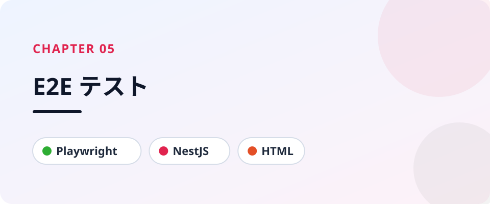

# E2E テスト



最後に、ブラウザで画面を操作して、画面から API までをまとめて確かめる **E2E（End to End）テスト** を書きます。道具は **Playwright** です。Playwright はブラウザ（Chromium・Firefox・WebKit）を動かし、人と同じように入力欄に文字を入れ、ボタンを押し、表示を確かめます。

この節では、次の 3 つを確かめます。

- メモを追加すると一覧に出て、読み込み直しても残っている
- 削除すると一覧から消える
- タイトルが空だと、API の入力チェックのエラーが画面に出る

## E2E テストでの認証も「トークンの直書き」にする

画面は、トークンが無いとメモを出せません。04 章と同じく、このハンズオンではテストの認証を **トークンの直書き** にします。

- API は、環境変数 `USE_FAKE_AUTH` が `true` のときだけ、04 章の `FakeTokenVerifier` を使う
- 画面は、はじめから `sessionStorage` の `token` を読んで API に送る作りになっている。Playwright で、画面のスクリプトが動く前に `alice-token` を入れておく

どちらも Playwright がテストのために起動するときだけで、ふだんの `npm start` の動きは変わりません。

:::warning
**本来は、E2E テストの認証は別の仕組みで行います。** たとえば、テスト用のユーザーで本当にサインインし、そのときのブラウザの状態を保存して、各テストで使い回します（Playwright の「setup project」と `storageState`）。このやり方なら、サインインの画面や Cognito とのやり取りまで確かめられます。このハンズオンでは、テストの書き方に集中するため、これには触れません。
:::

## API を偽物の認証に切り替えられるようにする

`AuthModule` で、`TokenVerifier` として渡すクラスを、環境変数で選ぶようにします。

::diff{file="api/src/auth/auth.module.ts"}

- `{ provide: TokenVerifier, useClass: ... }` … 「`TokenVerifier` が欲しいところには、このクラスを作って渡す」という書き方です。`AuthGuard` は `TokenVerifier` を受け取っているだけなので、中身が偽物になっても書き換えは要りません
- `process.env.USE_FAKE_AUTH === 'true'` … `true` という文字のときだけ偽物にします。書き忘れや書き間違いでは、本物のままです

偽物を使っているときは、起動のログに警告を出すようにします。

::diff{file="api/src/auth/fake-token-verifier.ts"}

```text
WARN [FakeTokenVerifier] 決め打ちのトークンで認証しています。テスト専用です
```

:::danger
`USE_FAKE_AUTH=true` のまま本番で動かすと、`alice-token` や `admin-token` を知っているだれもが、そのユーザーとして API を使えてしまいます。本番の環境変数には、決して書かないでください。
:::

### 画面でも試す

偽物の認証で API を起動すると、画面からメモを追加できるようになります。E2E テストを書く前に、手で動きを確かめておきます。

:::::platform
::::macos-linux
```bash
USE_FAKE_AUTH=true npm start
```
::::
::::windows
```powershell
$env:USE_FAKE_AUTH = 'true'; npm start
```

試し終わったら、`Ctrl + C` で止めてから、環境変数を消しておきます（PowerShell を閉じても消えます）。

```powershell
Remove-Item Env:USE_FAKE_AUTH
```
::::
:::::

<http://localhost:3000> を開き、「トークン」に `alice-token` を入れて **トークンを保存** を押すと、メモを追加・削除できます。`bob-token` に変えると、alice のメモは見えません。`admin-token` なら、全員のメモが見えます。

ふだんどおり `npm start` で起動し直すと、`alice-token` は `401`（`Invalid token`）に戻ります。

## Playwright を入れる

`api/` で、Playwright のテストの道具と、テストに使うブラウザ（Chromium）を入れます。

```bash
npm install -D @playwright/test
npx playwright install chromium
```

2 つ目のコマンドでダウンロードするブラウザは、`node_modules/` ではなく、パソコンの共通の場所に入ります。

:::::platform
::::macos
入る場所は `~/Library/Caches/ms-playwright/` です。
::::
::::windows
入る場所は `%USERPROFILE%\AppData\Local\ms-playwright\` です。
::::
::::linux
入る場所は `~/.cache/ms-playwright/` です。

Ubuntu では、ブラウザを動かすための部品が足りず、テストの起動でエラーになることがあります。そのときは `npx playwright install-deps chromium` で入れてください（中で `sudo` を使うので、パスワードを聞かれます）。
::::
:::::

`devDependencies` には `npm install` で `@playwright/test` が入ります。`scripts` の `test:e2e` は手で足します。`lint` にも、テストを置く `e2e/` を足します。

::diff{file="api/package.json"}

Playwright が作る結果とレポートは、Git に入れないようにします。

::diff{file="api/.gitignore"}

Playwright のテストも `*.spec.ts` の名前にするので、このままだと `npm test`（Vitest）が拾って、Vitest で動かそうとして落ちます。Vitest が見る場所を `src/` の下に絞ります。

::diff{file="api/vitest.config.ts"}

## Playwright の設定

::diff{file="api/playwright.config.ts"}

- `testDir: './e2e'` … テストは `e2e/` に置きます
- `reporter` … 結果を 1 行ずつ出し（`list`）、HTML のレポートも作ります（`html`）
- `use.baseURL` … `page.goto('/')` のように、パスだけで画面を開けるようになります
- `projects` … どのブラウザで動かすかです。この節では Chromium だけにしています
- `webServer` … テストの前に、`command` で API を起動します。`url` に応答が返るまで待ってからテストを始め、終わったら止めます
  - `env` で `PORT` を 3100 に、`USE_FAKE_AUTH` を `true` にします。環境変数は Playwright が渡すので、OS ごとの書き方の違いを気にしなくてかまいません
- `reuseExistingServer: !process.env.CI` … 手元では、3100 番でもう動いていれば、起動せずにそれを使います
- `trace: 'on-first-retry'` … 落ちたテストを動かし直すとき、操作の記録（トレース）を残します

ポートを 3100 にしているのは、ふだんの `npm start` の 3000 とぶつからないようにするためです。同じポートだと、`reuseExistingServer` が、偽物の認証になっていないふだんの API をそのまま使ってしまい、どのテストも `401` で落ちます。

## E2E テストを書く

::diff{file="api/e2e/notes.spec.ts"}

- `test('...', async ({ page }) => { ... })` … `page` は、Playwright が開いたブラウザのタブです。テストごとに新しいタブ（まっさらな状態）が用意されます
- `page.addInitScript(() => { ... })` … ページを開くたびに、ページのスクリプトより **先に** 動くスクリプトを足します。ここで `sessionStorage` に `alice-token` を入れるので、画面は最初から alice として API を呼びます。`page.reload()` で読み込み直したときにも動きます
- `page.getByPlaceholder('タイトル')`・`page.getByRole('button', { name: '追加' })` … 画面の要素を、**利用者から見える手がかり**（文言・役割）で探します。CSS のクラス名で探すより、見た目を変えても壊れにくくなります
- `.fill()`・`.click()` … 文字を入れる・押す操作です。要素が表示されて操作できるようになるまで、自動で待ちます
- `getByRole('listitem').filter({ hasText: title })` … 一覧の項目（`<li>`）のうち、そのタイトルを含むものに絞ります
- `getByRole('alert')` … エラーを出す `<p role="alert">` です
- `await expect(locator).toBeVisible()` … 表示されるまで、決まった時間（既定は 5 秒）待ちながら確かめ続けます。API からの応答を待つための `sleep` は要りません。`toHaveCount(0)` は「無くなるまで待つ」です
- `uniqueTitle()` … API のメモはメモリ上にあり、テストの間で共有されます。テストごとに違うタイトルにして、ほかのテストのメモと混ざらないようにしています

## 動かす

```bash
npm run test:e2e
```

```text
Running 3 tests using 1 worker

  ✓  1 [chromium] › e2e/notes.spec.ts:16:1 › メモを追加すると一覧に出て、読み込み直しても残っている (317ms)
  ✓  2 [chromium] › e2e/notes.spec.ts:35:1 › 削除すると一覧から消える (177ms)
  ✓  3 [chromium] › e2e/notes.spec.ts:46:1 › タイトルが空だと、API の入力チェックのエラーが出る (114ms)

  3 passed (3.0s)
```

最初に API のビルドと起動が入るので、全体では数秒かかります。

`npx playwright show-report` で、結果をブラウザで見られます。テストが落ちたときは、ここで、どこで止まったか・そのときの画面を確かめられます。

画面の動きを目で見たいときは、`npx playwright test --headed`（ブラウザを表示する）や `npx playwright test --ui`（1 つずつ動かして、操作と画面を見比べられる）を使います。

## このハンズオンでそろったテスト

| 種類 | コマンド（`api/` で） | 場所 | 数 |
|---|---|---|---|
| 単体テスト | `npm test` | `src/**/*.spec.ts` | 16 |
| 結合テスト | `npm run test:integration` | `test/*.integration-spec.ts` | 7 |
| E2E テスト | `npm run test:e2e` | `e2e/*.spec.ts` | 3 |

どれも、Cognito（AWS のアカウント）が無くても動きます。テストでは、トークンの検証だけを決め打ちのトークンを通す偽物に差し替え、それ以外の部品（Guard・Pipe・コントローラー・サービス・画面）は本物のまま確かめました。

## 参考にした公式ドキュメント

この節は、次の公式ドキュメントをもとに書いています。

- [Playwright: Installation](https://playwright.dev/docs/intro) … 入れ方と `npx playwright test`、動く OS
- [Playwright: Web server](https://playwright.dev/docs/test-webserver) … `webServer` でテストの前にサーバーを起動する（`command`・`url`・`env`・`reuseExistingServer`）
- [Playwright: Page](https://playwright.dev/docs/api/class-page#page-add-init-script) … `page.addInitScript()` がページのスクリプトより先に動くこと
- [Playwright: Authentication](https://playwright.dev/docs/auth) … 本来の認証のやり方（setup project と `storageState`）と、`sessionStorage` を `addInitScript()` で入れる方法
- [Playwright: Locators](https://playwright.dev/docs/locators) … `getByRole()`・`getByPlaceholder()`・`filter()`
- [Playwright: Assertions](https://playwright.dev/docs/test-assertions) … 待ちながら確かめる `toBeVisible()`・`toContainText()`・`toHaveCount()`
- [Playwright: Reporters](https://playwright.dev/docs/test-reporters) … `list` と `html` のレポーター、`show-report`
- [Playwright: Browsers](https://playwright.dev/docs/browsers) … ブラウザの入れ方と置き場所、`install-deps`
- [NestJS: Custom providers](https://docs.nestjs.com/fundamentals/custom-providers) … `{ provide, useClass }` で渡すクラスを選ぶ

## この節を終えたときのディレクトリ

::tree

:::download
[この節を終えた状態をダウンロード](./project.zip)
:::

:::faq

### `npm init playwright@latest` は使わないの？

使っても構いません。設定ファイルと見本のテストを作り、ブラウザも入れてくれます。この節では、何が入るのかが分かるように、1 つずつ入れて書いています。

### どのテストも `401`（`Missing bearer token` や `Invalid token`）で落ちる

偽物の認証になっていない API を使っている可能性があります。3100 番で、`USE_FAKE_AUTH` を付けずに起動した API が動いていないか確かめてください（`reuseExistingServer` が、それをそのまま使います）。止めてから動かし直すと、Playwright が偽物の認証で起動し直します。

### `Process from config.webServer was not able to start` と出る

Playwright が API を起動できませんでした。すぐ上に理由が出ています。`EADDRINUSE: address already in use :::3100` なら、3100 番をほかのプログラムが使っています。macOS・Linux なら `lsof -i :3100`、Windows の PowerShell なら `Get-Process -Id (Get-NetTCPConnection -LocalPort 3100).OwningProcess` で探して止めてください。

### `USE_FAKE_AUTH=true` を `api/.env` に書いても効かない

効きません。`AuthModule` が環境変数を読むのは、`main.ts` が `.env` を読み込むより前（ファイルが読み込まれたとき）だからです。偽物の認証は、Playwright の `webServer.env` か、起動のコマンドで渡したときだけ使われます。間違って `.env` に書いて本番に持ち込む心配が減るので、このままにしています。

### Firefox や Safari（WebKit）でも確かめたい

`npx playwright install firefox webkit` でブラウザを入れ、`projects` に `{ name: 'firefox', use: { ...devices['Desktop Firefox'] } }` などを足します。

:::
