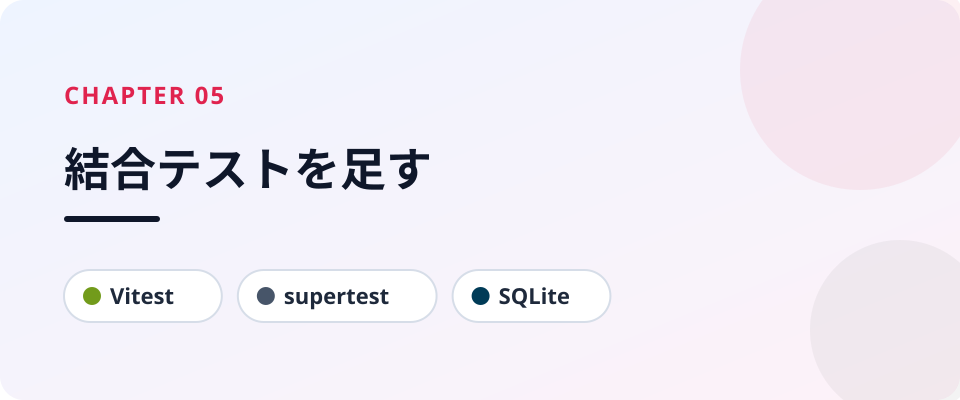

# 結合テストを足す



[結合テストの設計](../01-design/LECTURE.md) の表の残りを足し、3 件をそろえます。

| 番号 | 前の節 | この節 |
|---|---|---|
| I1 | メンバーを 1 人足すところだけ | 3 人と立て替えを足し、3 つの表を確かめる形に広げる |
| I2 | なし | 足す（`GET /settlement` の清算） |
| I3 | なし | 足す（立て替えが無いときの清算） |

## テストを足す

::diff{file="apps/api/test/settlement.e2e-spec.ts"}

- `seed()` … 3 人のメンバーを足し、A が 3 人分の 10,000 円を立て替えた状態にします。I1 と I2 で同じものを使うので、関数にまとめます
- I1 … 立て替えを記録すると、`payments` と `payment_participants` の 2 つの表に書かれることも確かめます
- I2 … `res.body` で、応答の本文（JSON）を確かめます
- I3 … テストごとに新しい DB を使うので、何も足さなければ表は空です

## 動かす

```bash
npm run test:e2e
```

```text
 ✓ test/settlement.e2e-spec.ts (3 tests) 79ms

 Test Files  1 passed (1)
      Tests  3 passed (3)
```

## 参考にした公式ドキュメント

この節は、次の公式ドキュメントをもとに書いています。

- [NestJS: Testing](https://docs.nestjs.com/fundamentals/testing) … supertest で HTTP を送り、応答を確かめるテスト
- [Node.js: SQLite](https://nodejs.org/docs/latest-v26.x/api/sqlite.html) … `prepare().all()`

## この節を終えたときのディレクトリ

::tree

:::download
[この節を終えた状態をダウンロード](./project.zip)
:::
