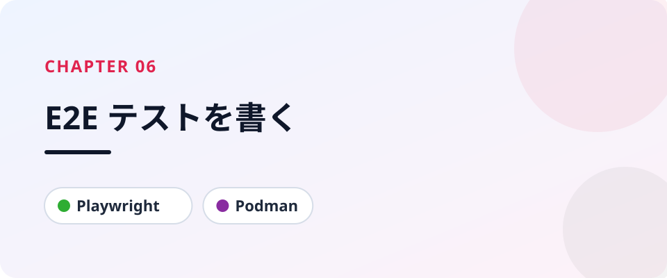

# E2E テストを書く



前の節で設計した表のうち、E1（メンバーを 1 人足すと一覧に出る）だけをテストに書いて動かします。

## Playwright を入れる

E2E テストは画面を操作して確かめるテストなので、画面のプロジェクト（`apps/ui/`）に置きます。ブラウザを操作する道具の **Playwright** は、`apps/ui/` を npm のプロジェクトにして入れます。テストで使うブラウザ（Chromium）も入れます。ルート（`warikan/`）から始めます。

```bash
cd apps/ui
npm init -y
npm install -D @playwright/test
npx playwright install chromium
```

Linux（Ubuntu など）で、テストの起動時にブラウザの部品が足りないというエラーが出たら、`npx playwright install-deps chromium` で入れます（`sudo` のパスワードを聞かれます）。

::diff{file="apps/ui/package.json" by="command"}

テストを置く場所（`e2e/`）と、開く画面（`http://localhost:3000`）を設定します。

::diff{file="apps/ui/playwright.config.ts"}

ライブラリと、Playwright が作る結果とレポートを、Git に入れないようにします。画面として配るのは `public/` だけなので、ここに置いたものは nginx からは見えません。

::diff{file="apps/ui/.gitignore"}

## テストを書く

::diff{file="apps/ui/e2e/settlement.spec.ts"}

- `test('...', async ({ page, request }) => { ... })` … テスト 1 つです。`page` は開いたブラウザのページ、`request` は API を直接呼ぶ道具です
- `request.get('http://localhost:3001/members')` … 画面を操作する前に、データが空であることを API で確かめます。前のデータが残っていると、メンバーの数が合わずに、たまたま通ったり落ちたりします。ここで落ちれば、データを消し忘れたことがすぐ分かります
- `page.goto('/')` … `baseURL`（`http://localhost:3000`）の画面を開きます
- `page.getByLabel('名前')`・`page.getByRole('button', { name: 'メンバーを足す' })` … 画面に出ている文字（ラベル・ボタンの名前）で、操作するところ（ロケーター）を選びます
- `getByRole('list', { name: 'メンバー' })` … 「メンバー」の見出しが付いたリストです
- `expect(members).toHaveCount(1)` … 一覧が 1 人になるまで待ってから確かめます。API の応答を待つための `sleep` は要りません。数を決めて待つので、2 人目が出たときは落ちます

## 動かす

テストは、データが空の状態から始めます。ルート（`warikan/`）で、データをボリュームごと消して、起動し直します。

```bash
podman compose down --volumes
podman compose up -d --build --wait
```

`apps/ui/` でテストを流します。

```bash
npx playwright test
```

```text
Running 1 test using 1 worker

  ✓  1 [chromium] › e2e/settlement.spec.ts:3:1 › メンバーを足すと、一覧に出る (156ms)

  1 passed (482ms)
```

データを消さずにもう一度動かすと、最初の確かめで落ちます。上の 2 つのコマンドでデータを消してから動かします。

```text
    Error: expect(received).toEqual(expected) // deep equality

    - Expected  - 1
    + Received  + 6

    - Array []
    + Array [
    +   Object {
    +     "id": 1,
    +     "name": "A",
    +   },
    + ]
```

テストが落ちたときは、`npx playwright show-report` で、どこで止まったか・そのときの画面を確かめられます。

## 参考にした公式ドキュメント

この節は、次の公式ドキュメントをもとに書いています。

- [Playwright: Installation](https://playwright.dev/docs/intro) … 入れ方と `npx playwright test`
- [Playwright: Browsers](https://playwright.dev/docs/browsers) … `npx playwright install chromium` と `install-deps`
- [Playwright: Test configuration](https://playwright.dev/docs/test-configuration) … `testDir`・`reporter`・`use.baseURL`・`projects`
- [Playwright: Locators](https://playwright.dev/docs/locators) … `getByLabel()`・`getByRole()`
- [Playwright: Assertions](https://playwright.dev/docs/test-assertions) … `toHaveCount()`・`toHaveText()`
- [Playwright: API testing](https://playwright.dev/docs/api-testing) … `request` で API を直接呼ぶ
- [Docker: docker compose down](https://docs.docker.com/reference/cli/docker/compose/down/) … `--volumes`

## この節を終えたときのディレクトリ

::tree

:::download
[この節を終えた状態をダウンロード](./project.zip)
:::
