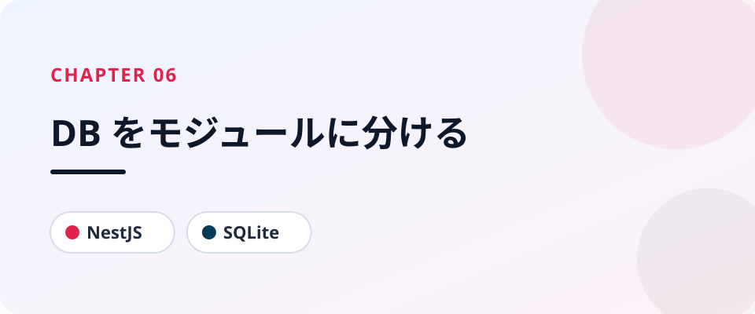
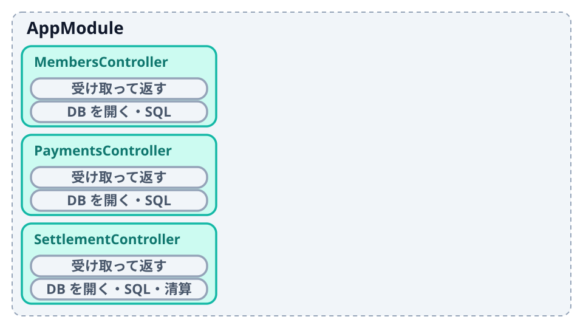
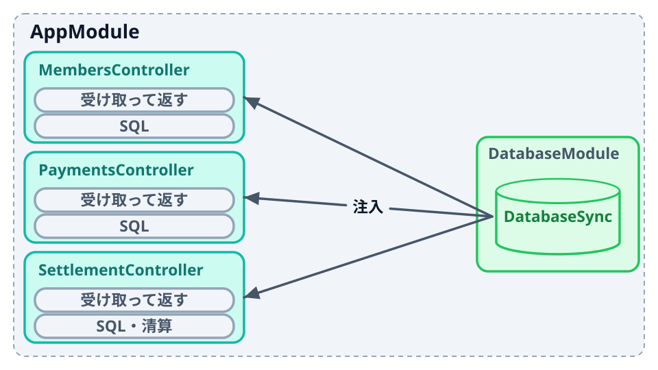

# DB をモジュールに分ける



03 章で単体テストできたのは、DB も HTTP も使わない計算の関数だけでした。清算を出すところ（`SettlementController`）は、自分で DB を開いて SQL を書いているので、DB 無しでは確かめられません。この章では、NestJS の **DI**（依存性の注入）を使う形に少しずつ書き換え、清算を出すところも単体テストできるようにします。各節の最後に、04 章の結合テストで動きが変わっていないことを確かめます。

今は、3 つのコントローラーが、それぞれ DB を開き、SQL を書いています。この章の図では、節ごとに、その節で分けたものに色を付けます。



最初は DB です。コントローラーが自分で `openDatabase()` を呼ぶのをやめ、NestJS に **プロバイダー** として渡してもらいます。DB はどの機能からも使うものなので、`DatabaseModule` という **モジュール** にまとめます。



```bash
npx nest g module database
```

```text
CREATE src/database/database.module.ts (85 bytes)
UPDATE src/app.module.ts (634 bytes)
```

`nest g module` は、`AppModule` の `imports` に `DatabaseModule` を足します。

::diff{file="api/src/app.module.ts" by="command"}

`src/database.ts` を、できた `src/database/` フォルダに移します（中身は変えません）。

::diff{file="api/src/database/database.module.ts" base="generated"}

- `{ provide: DatabaseSync, useFactory: openDatabase }` … 「`DatabaseSync` を受け取りたいクラスには、`openDatabase()` が返したものを渡す」という登録です。NestJS は `openDatabase()` を 1 回だけ呼び、同じ DB を使い回します
- `exports: [DatabaseSync]` … `DatabaseModule` を読み込んだモジュール（ここでは `AppModule`）でも、`DatabaseSync` を受け取れるようにします

::diff{file="api/src/members/members.controller.ts"}

::diff{file="api/src/payments/payments.controller.ts"}

::diff{file="api/src/settlement/settlement.controller.ts"}

- `constructor(private readonly db: DatabaseSync)` … 引数の型を見て、NestJS が `DatabaseModule` で登録した DB を渡します（02 章で見た `AppService` と同じ依存性の注入です）

## 動作確認する

04 章の結合テストを動かします。テストのコードは変えていません。

```bash
npm run test:e2e
```

```text
 Test Files  1 passed (1)
      Tests  3 passed (3)
```

3 つとも通れば大丈夫です。書き換えても、HTTP で呼んだときの動きは変わっていません。

## 参考にした公式ドキュメント

この節は、次の公式ドキュメントをもとに書いています。

- [NestJS: CLI command reference](https://docs.nestjs.com/cli/usages) … `nest generate module`
- [NestJS: Custom providers](https://docs.nestjs.com/fundamentals/custom-providers) … `provide` と `useFactory`
- [NestJS: Modules](https://docs.nestjs.com/modules) … `exports` でプロバイダーをほかのモジュールに渡す（Shared modules）

## この節を終えたときのディレクトリ

::tree

:::download
[この節を終えた状態をダウンロード](./project.zip)
:::
