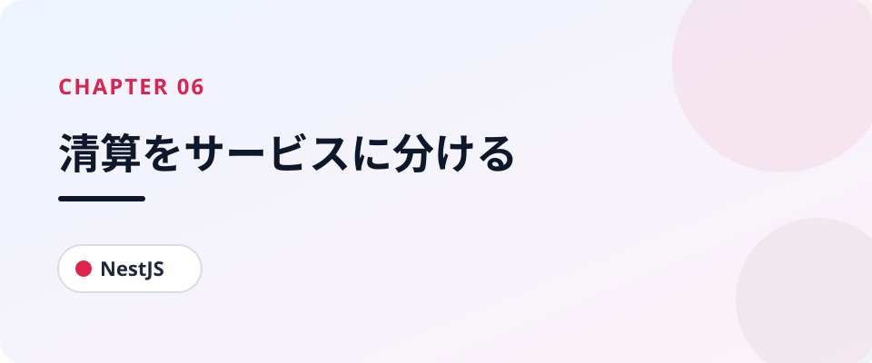

# 清算をサービスに分ける



清算を出す処理を、コントローラーから **サービス**（`SettlementService`）に移します。サービスは、立て替えを読むリポジトリを自分で作らず、DI で受け取ります。

::diff{file="api/src/settlement/settlement.service.ts"}

::diff{file="api/src/app.module.ts"}

::diff{file="api/src/settlement/settlement.controller.ts"}

- コントローラーは「受け取って、サービスを呼んで、返す」だけになります

## 振る舞いが変わっていないことを確かめる

04 章の結合テストを動かします。テストのコードは変えていません。

```bash
npm run test:integration
```

```text
 Test Files  1 passed (1)
      Tests  3 passed (3)
```

コードを書き換えても、HTTP で呼んだときの振る舞いは変わっていません。

## 参考にした公式ドキュメント

この節は、次の公式ドキュメントをもとに書いています。

- [NestJS: Providers](https://docs.nestjs.com/providers) … サービスと、コンストラクターでの依存性の注入

## この節を終えたときのディレクトリ

::tree

:::download
[この節を終えた状態をダウンロード](./project.zip)
:::
