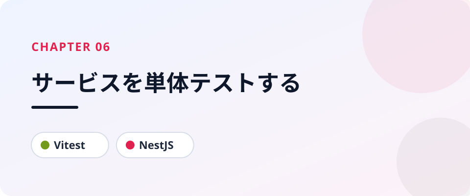
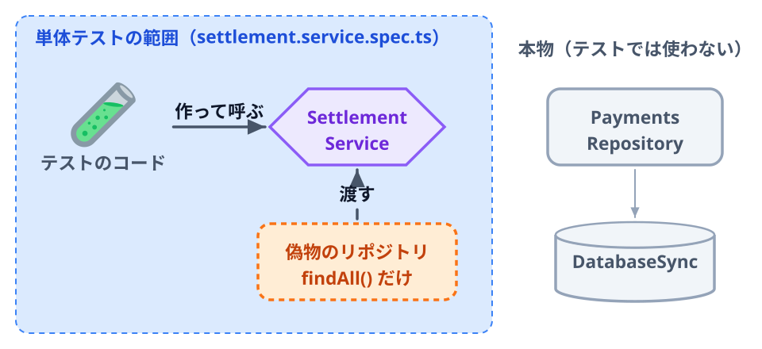

# サービスを単体テストする



`SettlementService` は、立て替えを読むリポジトリをコンストラクターで受け取ります。テストでは、DB を読む本物の代わりに、決まった立て替えを返す偽物を渡します。こうすると、DB も HTTP も使わずに、清算を出すところを単体テストできます。



::diff{file="api/src/settlement/settlement.service.spec.ts"}

- `fakeRepository(payments)` … `findAll()` が決まった立て替えを返すだけの偽物です。`SettlementService` が使うのは `findAll()` だけなので、ほかは要りません
- `new SettlementService(fakeRepository([...]))` … NestJS を通さず、コンストラクターに偽物を渡して作ります

## 動かす

```bash
npm test
```

```text
 ✓ src/settlement/settle.spec.ts (10 tests) 2ms
 ✓ src/settlement/settlement.service.spec.ts (3 tests) 2ms

 Test Files  2 passed (2)
      Tests  13 passed (13)
```

04 章の結合テストも、そのまま通ります。

```bash
npm run test:e2e
```

```text
 Test Files  1 passed (1)
      Tests  3 passed (3)
```

## 単体テストで確かめられるようになったこと

| 確かめること | 04 章の結合テスト | この節の単体テスト |
|---|---|---|
| 立て替えから、正しい清算が出る | DB に書いてから `GET /settlement` で確かめる | 偽物のリポジトリで確かめる |
| 立て替えが無ければ、清算は空 | DB を空にして確かめる | 偽物のリポジトリで確かめる |
| いくつもの立て替えを、まとめて差し引きする | （書いていない） | 偽物のリポジトリで確かめる |
| メンバーと立て替えが、表に正しく入る | SQL で表を読んで確かめる | 確かめない（SQL はリポジトリの仕事なので、結合テストで確かめる） |

DI にしたので、清算の決まりは、結合テストに頼らなくても単体テストでしっかり確かめられるようになりました。結合テストには、DB に正しく書けることのように、つないでみないと分からないことだけを任せます。

## 参考にした公式ドキュメント

この節は、次の公式ドキュメントをもとに書いています。

- [NestJS: Testing](https://docs.nestjs.com/fundamentals/testing) … DI で受け取るものを、テストで偽物に差し替える
- [Vitest: expect](https://vitest.dev/api/expect) … `toEqual`

## この節を終えたときのディレクトリ

::tree

:::download
[この節を終えた状態をダウンロード](./project.zip)
:::
