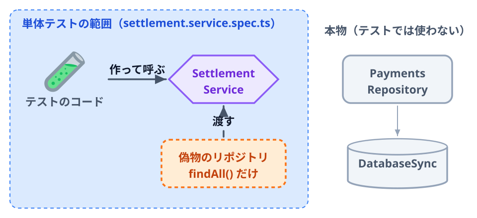

# 偽物に差し替えてテストする


`SettlementService` は、立て替えを読むリポジトリをコンストラクターで受け取ります。テストでは、DB を読む本物の代わりに、決まった立て替えを返す偽物を渡します。こうすると、DB も HTTP も使わずに、清算を出すところを単体テストできます。



::diff{file="apps/api/src/settlement/settlement.service.spec.ts"}

- `fakeRepository(payments)` … `findAll()` が決まった立て替えを返すだけの偽物です。`SettlementService` が使うのは `findAll()` だけなので、ほかは要りません
- `new SettlementService(fakeRepository([...]))` … NestJS を通さず、コンストラクターに偽物を渡して作ります

## 動かす

```bash
npm test
```

```text
 ✓ src/settlement/settle.spec.ts (10 tests) 2ms
 ✓ src/settlement/settlement.service.spec.ts (3 tests) 2ms

 Test Files  2 passed (2)
      Tests  13 passed (13)
```

05 章の結合テストも、そのまま通ります。

```bash
npm run test:e2e
```

```text
 Test Files  1 passed (1)
      Tests  3 passed (3)
```

## 起動しないで確かめられるようになったこと

05 章の結合テストと、この節の単体テストは、どちらも「立て替えから正しい清算が出るか」を確かめています。

| | 05 章の結合テスト | この節の単体テスト |
|---|---|---|
| 起動するもの | Nest のアプリ・HTTP・一時ファイルの DB | 無し（`SettlementService` と偽物のリポジトリだけ） |
| かかった時間（3 件、Vitest の `tests`） | 75ms | 2ms |
| 確かめていること | 立て替えから正しい清算が出る（ほかに、表に正しく入ること） | 立て替えから正しい清算が出る |

時間は、手元の Mac で両方を流して出た数字です。同じ清算の決まりを、アプリも DB も起動しないで確かめています。

この章で DI コンテナを使ってサービスに切り出したので、これまで結合テストでしか確かめられなかったことが、アプリも DB も実際に起動しなくても確かめられるようになりました。ただし、DB に正しく書けるかのようなつなぎ目は、これからも結合テストで確かめます。

## 参考にした公式ドキュメント

この節は、次の公式ドキュメントをもとに書いています。

- [NestJS: Testing](https://docs.nestjs.com/fundamentals/testing) … DI で受け取るものを、テストで偽物に差し替える
- [Vitest: expect](https://vitest.dev/api/expect) … `toEqual`

## この節を終えたときのディレクトリ

::tree

:::download
[この節を終えた状態をダウンロード](./project.zip)
:::
