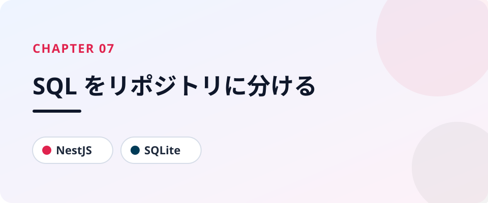
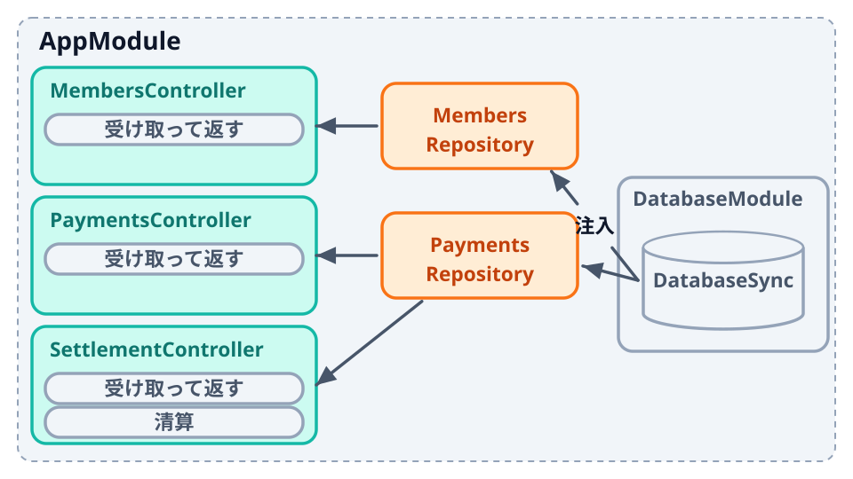

# SQL をリポジトリに分ける



コントローラーに書いてある SQL を、表ごとの **リポジトリ** に移します。立て替えを読む SQL は `PaymentsController` と `SettlementController` の 2 か所にありましたが、`PaymentsRepository` の 1 か所にまとまります。DB は、コントローラーではなくリポジトリに注入します。



::diff{file="api/src/members/members.repository.ts"}

::diff{file="api/src/payments/payments.repository.ts"}

- メソッドの中身は、コントローラーにあったものをそのまま移しています
- `@Injectable()` … NestJS が作って、ほかのクラスに渡せるようにする印です。DB は前の節と同じく、コンストラクターで受け取ります

リポジトリを `AppModule` の `providers` に登録し、コントローラーはリポジトリを受け取って呼ぶだけにします。

::diff{file="api/src/app.module.ts"}

::diff{file="api/src/members/members.controller.ts"}

::diff{file="api/src/payments/payments.controller.ts"}

::diff{file="api/src/settlement/settlement.controller.ts"}

## 動作確認する

05 章の結合テストを動かします。テストのコードは変えていません。

```bash
npm run test:e2e
```

```text
 Test Files  1 passed (1)
      Tests  3 passed (3)
```

3 つとも通れば大丈夫です。

## 参考にした公式ドキュメント

この節は、次の公式ドキュメントをもとに書いています。

- [NestJS: Providers](https://docs.nestjs.com/providers) … `@Injectable()` と、コンストラクターでの依存性の注入、`providers` への登録

## この節を終えたときのディレクトリ

::tree

:::download
[この節を終えた状態をダウンロード](./project.zip)
:::
