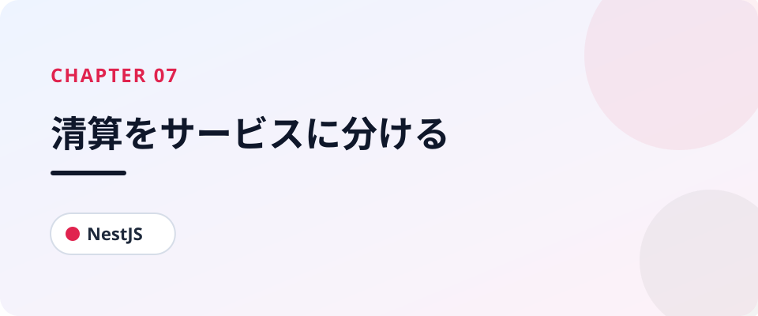
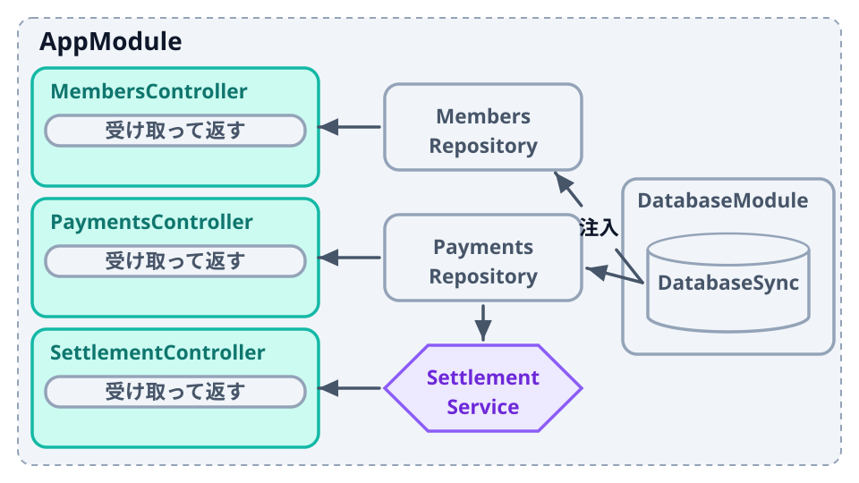

# 清算をサービスに分ける



清算を出す処理を、コントローラーから **サービス**（`SettlementService`）に移します。サービスは、立て替えを読むリポジトリを自分で作らず、DI で受け取ります。



```bash
npx nest g service settlement --no-spec
```

```text
CREATE src/settlement/settlement.service.ts (94 bytes)
UPDATE src/app.module.ts (905 bytes)
```

`--no-spec` は、テストのひな形（`settlement.service.spec.ts`）を作らない指定です。サービスのテストは、次の節で自分で書きます。`AppModule` の `providers` に `SettlementService` が登録されます。

::diff{file="api/src/app.module.ts" by="command"}

::diff{file="api/src/settlement/settlement.service.ts" base="generated"}

::diff{file="api/src/settlement/settlement.controller.ts"}

- コントローラーは「受け取って、サービスを呼んで、返す」だけになります

## 動作確認する

05 章の結合テストを動かします。テストのコードは変えていません。

```bash
npm run test:e2e
```

```text
 Test Files  1 passed (1)
      Tests  3 passed (3)
```

3 つとも通れば大丈夫です。

## 参考にした公式ドキュメント

この節は、次の公式ドキュメントをもとに書いています。

- [NestJS: CLI command reference](https://docs.nestjs.com/cli/usages) … `nest generate service` と `--no-spec`
- [NestJS: Providers](https://docs.nestjs.com/providers) … サービスと、コンストラクターでの依存性の注入

## この節を終えたときのディレクトリ

::tree

:::download
[この節を終えた状態をダウンロード](./project.zip)
:::
