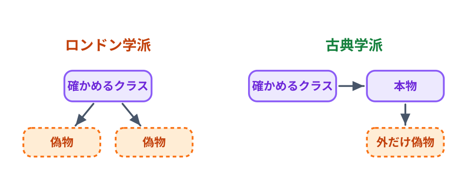
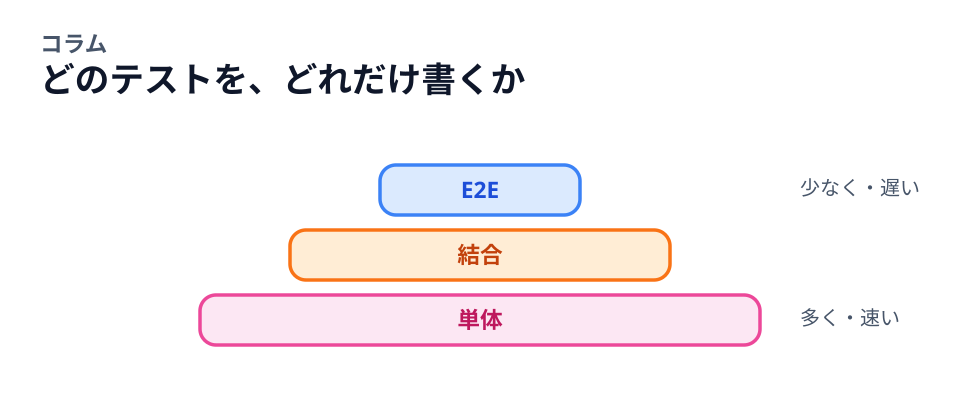
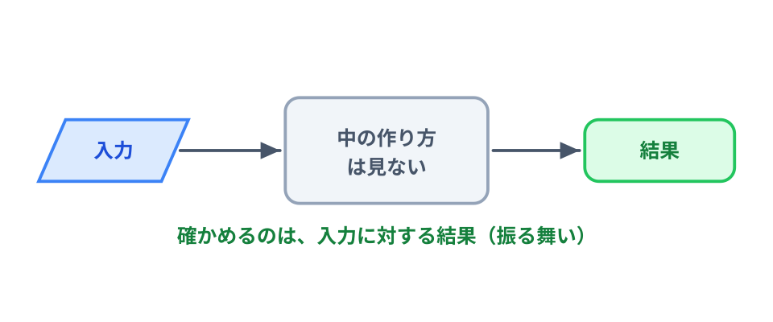
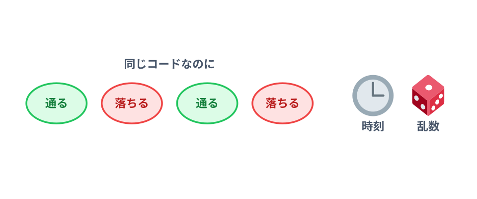
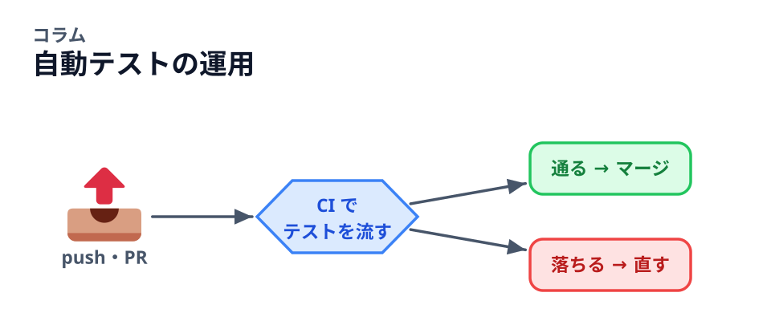

# コラム

本編で書いたテストの、まわりの話を集めたコラムです。それぞれのコラムは続いていないので、好きなものから読んでかまいません。

## [テスト駆動開発と自動テスト](../01-tdd/LECTURE.md)

「テストを書く」と「テスト駆動開発」は同じものだと思っていませんか。2 つのちがいと、レッド・グリーン・リファクタリングの回し方を見ます。

## [ロンドン学派と古典学派](../02-london-classic/LECTURE.md)

単体テストの「単体」は、クラス 1 つのことでしょうか、それとも振る舞いのまとまりでしょうか。考え方の 2 つの流派と、このハンズオンがどちらに近いかを見ます。

## [データベースのテストはしないのか](../03-database-test/LECTURE.md)

単体テストから DB を外すと、DB はどこで確かめるのか気になりませんか。DB を確かめる場所と、テスト用の DB の用意の仕方を見ます。

## [防御的プログラミングと攻撃的プログラミング](../04-defensive-offensive/LECTURE.md)

おかしな値が来たら、黙って直すべきか、すぐ止めるべきか、迷ったことはありませんか。2 つの考え方と、テストとの関係を見ます。

## [どのテストを、どれだけ書くか](../05-how-many/LECTURE.md)

単体・結合・E2E を、それぞれどれくらい書けばよいか迷いませんか。よく使われる目安の形と、はじめの一歩を見ます。

## [何をテストするか](../06-what-to-test/LECTURE.md)

テストを書こうとして、何を確かめればよいか手が止まったことはありませんか。確かめるところの選び方を見ます。

## [テストダブルの種類](../07-test-doubles/LECTURE.md)

「モック」と「スタブ」は何がちがうのか、気になったことはありませんか。本物の代わりに渡すもの（テストダブル）の種類を見ます。

## [不安定なテストと扱いにくいもの](../08-flaky/LECTURE.md)

同じコードなのに、流すたびに通ったり落ちたりするテストに困ったことはありませんか。原因と、時刻や乱数の扱い方を見ます。

## [自動テストの運用](../09-operation/LECTURE.md)

テストを書いたのに、いつのまにか誰も流さなくなった、ということはありませんか。テストを続けて役立てるための運用を見ます。
