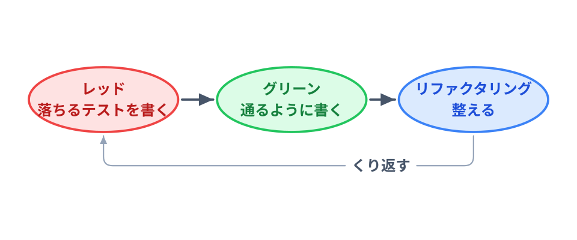

# テスト駆動開発と自動テスト

「テストを書く」と「テスト駆動開発」は同じものだと思っていませんか。2 つのちがいと、レッド・グリーン・リファクタリングの回し方を見ます。

## 自動テストとテスト駆動開発は別のもの

**自動テスト** は、動きを確かめる手順をコードにしておき、何度でも同じように流せるようにすることです。このハンズオンの 04〜07 章で書いたものは、どれも自動テストです。

**テスト駆動開発**（TDD）は、テストを先に書き、そのテストを道しるべにしてコードを書いていく進め方です。自動テストは「何を持っているか」、TDD は「どの順で作るか」の話なので、自動テストはあっても TDD はしていない、ということはふつうにあります。

## レッド・グリーン・リファクタリング

TDD は、次の 3 つの段階をくり返します。

1. **レッド** … まだ動かない、落ちるテストを 1 つ書く
2. **グリーン** … そのテストが通るだけのコードを書く
3. **リファクタリング** … テストが通ったまま、コードを読みやすく整える

1 回の輪は小さく回します。たとえば `split` なら、「9,000 円を 3 人で分けると 3,000 円ずつ」のテストを書いて通し、次に「10,000 円を 3 人で分けると、余りの 1 円を前の人に付ける」のテストを足して通す、と 1 つずつ進めます。

## このハンズオンとの関係

本編は、できあがっている割り勘のアプリに、あとからテストを書いています。TDD とは順番が逆です。

ただ、[04 章の単体テストの設計](../../04-unit-test/01-design/LECTURE.md) で、先に「入力 → 期待する結果」の表を作り、[ふつうのケースを 1 つ書き](../../04-unit-test/02-first-test/LECTURE.md)、[残りを足していった](../../04-unit-test/03-more-cases/LECTURE.md) 進め方は、TDD の手前の考え方に近いものです。表の行を「まだ無い機能のテスト」として 1 つずつ書けば、そのまま TDD になります。

## 向いている場面・向いていない場面

TDD が向いているのは、`split`・`balances`・`settle` のように、入力と結果がはっきり決まっている計算や業務の決まりです。期待する結果を先に書けるので、テストが道しるべになります。

反対に、画面の見た目のように形がまだ決まっておらず、試しながら作るところでは、先にテストを書いてもすぐに書き直すことになります。そうしたところは、形が落ち着いてからテストを足します。

## 参考

- [Kent Beck『テスト駆動開発』（オーム社）](https://www.ohmsha.co.jp/book/9784274217883/) … レッド・グリーン・リファクタリングと、小さく進める TDD
- [Martin Fowler: TestDrivenDevelopment](https://martinfowler.com/bliki/TestDrivenDevelopment.html) … TDD の手順と、自動テストを先に書くこと
