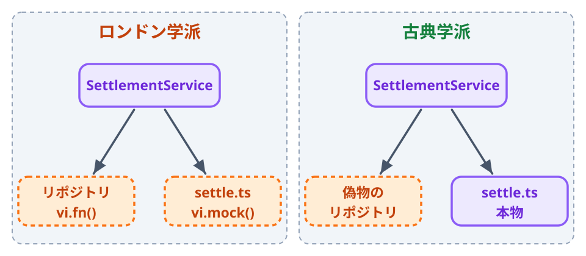

# ロンドン学派と古典学派


単体テストの「単体」は、クラス 1 つのことでしょうか、それとも振る舞いのまとまりでしょうか。考え方の 2 つの流派と、このハンズオンがどちらに近いかを見ます。

## 2 つの学派

単体テストの「単体」をどう見るかで、2 つの考え方があります。

- **ロンドン学派**（モックを多く使う学派）… 単体を「クラス 1 つ」と見る。確かめるクラスの相手は、すべて偽物（モック）にする
- **古典学派**（デトロイト学派とも呼ぶ）… 単体を「振る舞いのまとまり」と見る。DB のような外のものだけを偽物にし、中のクラスや関数は本物でつなぐ

ここでは、[07 章で作った `SettlementService`](../../07-di-container/03-service/LECTURE.md) を題材に、2 つの書き方を並べます。コードは考え方をつかむためのもので、本編のプロジェクトには入れません。



## ロンドン学派のテスト

リポジトリを `vi.fn()` のモックにし、計算の関数も `vi.mock()` でモックにします。確かめるのは、清算の結果ではなく、`SettlementService` が相手をどう呼んだかです。

```ts
import { expect, it, vi } from 'vitest';
import type { PaymentsRepository } from '../payments/payments.repository.js';
import { balances, settle } from './settle.js';
import { SettlementService } from './settlement.service.js';

vi.mock('./settle.js'); // 計算の関数もモックにする

it('立て替えを読み、balances と settle を順に呼ぶ', () => {
  const payments = [
    { id: 1, payerId: 1, amount: 9000, memo: '',
      participantIds: [1, 2, 3] },
  ];
  const repository = { findAll: vi.fn(() => payments) };
  vi.mocked(balances).mockReturnValue([{ memberId: 1, amount: 6000 }]);
  const service = new SettlementService(
    repository as unknown as PaymentsRepository,
  );

  service.settlement();

  expect(repository.findAll).toHaveBeenCalledOnce();
  expect(balances).toHaveBeenCalledWith(payments);
  expect(settle).toHaveBeenCalledWith([{ memberId: 1, amount: 6000 }]);
});
```

## 古典学派のテスト

[07 章の偽物に差し替えるテスト](../../07-di-container/04-service-test/LECTURE.md) と同じ形です。外のもの（立て替えを読むリポジトリ）だけを、決まった立て替えを返す偽物にし、計算の関数は本物を使います。確かめるのは、返ってきた清算です。

```ts
it('リポジトリの立て替えから、清算を出す', () => {
  const service = new SettlementService(
    fakeRepository([
      { id: 1, payerId: 1, amount: 10000, memo: '飲み会',
        participantIds: [1, 2, 3] },
    ]),
  );

  expect(service.settlement()).toEqual([
    { from: 2, to: 1, amount: 3333 },
    { from: 3, to: 1, amount: 3333 },
  ]);
});
```

## 2 つの実験

2 つのテストがある状態で、コードを次のように変えたとします。

| 変えたこと | ロンドン学派のテスト | 古典学派のテスト |
|---|---|---|
| 作り方を変える（`settlement()` の中を書き換え、`balances` を呼ばずに同じ清算を出す。結果は同じ） | 落ちる | 通る |
| 計算にバグを入れる（`settle` で、払う人と受け取る人を逆にする） | 通る | 落ちる |

ロンドン学派のテストは「どう呼んだか」を確かめているので、結果が同じでも作り方を変えると落ちます。計算の関数をモックにしているので、計算のまちがいには気づきません。古典学派のテストは結果だけを見ているので、作り方の変更では落ちず、計算のまちがいで落ちます。

## このハンズオンはどちらか

このハンズオンは古典学派に近い形です。07 章で偽物にしたのは、DB の手前のリポジトリだけで、`split`・`balances`・`settle` は本物のまま使っています。そのため、[04 章の計算の関数のテスト](../../04-unit-test/03-more-cases/LECTURE.md) と 07 章のサービスのテストの両方が、清算の決まりを確かめています。

## 選び方の目安

作り方を少し変えるたびにテストを直しているなら、偽物を使いすぎているかもしれません。まずは、遅いもの・外のもの（DB・外の API・時刻）だけを差し替え、中は本物でつなぐところから始めます。相手を呼んだこと自体が大事なとき（たとえば「メールを 1 通だけ送る」）は、ロンドン学派のようにモックで呼び出しを確かめます。

## 参考

- [Martin Fowler: Mocks Aren't Stubs](https://martinfowler.com/articles/mocksArentStubs.html) … 古典的な TDD とモックを使う TDD（mockist。ロンドンとも呼ばれる）のちがい
- [Martin Fowler: UnitTest](https://martinfowler.com/bliki/UnitTest.html) … 相手を偽物にする solitary と、本物とつなぐ sociable
- [Vitest: Mocking](https://vitest.dev/guide/mocking) … `vi.mock()` でモジュールをモックにする
- [Vitest: vi](https://vitest.dev/api/vi) … `vi.fn()`・`vi.mocked()`
