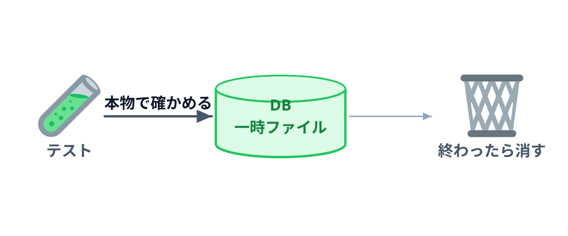

# データベースのテストはしないのか

単体テストから DB を外すと、DB はどこで確かめるのか気になりませんか。DB を確かめる場所と、テスト用の DB の用意の仕方を見ます。

## 単体テストから DB を外す理由

[07 章](../../07-di-container/04-service-test/LECTURE.md) では、`SettlementService` の単体テストで、DB を読むリポジトリを偽物にしました。DB を外すのは、次の 3 つの理由からです。

- **遅い** … ファイルやサーバーを開き、表を作る分だけ時間がかかる
- **用意と後片付けが要る** … テストの前に表とデータを用意し、終わったら消す
- **テストどうしが影響し合う** … 前のテストが入れたデータが残ると、次のテストの結果が変わる

DB を外せば、清算の決まりを速く、何度でも同じように確かめられます。

## それでも DB を確かめる場所

DB を外したからといって、DB を確かめなくてよいわけではありません。偽物のリポジトリは、こちらが決めた立て替えを返すだけなので、SQL のまちがい（列の名前のまちがい、`payment_participants` への書き忘れなど）は見つかりません。

このハンズオンでは、[05 章の結合テスト](../../05-integration-test/03-more-cases/LECTURE.md) が、本物の SQLite に書き込み、表を直接読んで確かめています。

| 確かめること | どこで |
|---|---|
| 清算の決まり（端数・差し引き） | 04 章・07 章の単体テスト（DB なし） |
| SQL で表に正しく書けるか・読めるか | 05 章の結合テスト（本物の SQLite） |

## テスト用の DB の用意の仕方

テスト用の DB は、ふだん使う DB と分けます。よく使う形は 3 つです。

- **一時ファイル** … 本編の 05 章の形。`DB_PATH` に一時フォルダの新しいファイルを指し、テストが終わったら消す
- **メモリ上の DB** … SQLite は `':memory:'` を開くと、ファイルを作らずにメモリの中だけで動く
- **コンテナの DB** … PostgreSQL や MySQL のような DB は、テストのたびにコンテナで起動する（Testcontainers などの道具がある）

どの形でも、テストごとに空の DB から始めます。05 章で `beforeEach()` のたびに新しいファイルを作っているのは、このためです。

## DB を偽物にしすぎる危険

偽物は、本物と同じように動くとは限りません。たとえば、偽物のリポジトリは立て替えを ID の順に返していても、本物の SQL に `ORDER BY` が無ければ、順番は決まりません。偽物だけでテストしていると、テストは通るのに本番で壊れます。

DB とのつなぎ目は、少しでよいので本物の DB で確かめます。単体テストで決まりを広く、結合テストでつなぎ目を少し、という分け方です。

## 参考

- [Node.js: SQLite](https://nodejs.org/docs/latest-v26.x/api/sqlite.html) … `DatabaseSync` と、`':memory:'` で開くメモリ上の DB
- [Testcontainers](https://testcontainers.com/) … テストのたびに DB などをコンテナで起動する道具
- [Software Engineering at Google: Test Doubles](https://abseil.io/resources/swe-book/html/ch13.html) … 偽物を使いすぎる危険と、本物を使う場面
