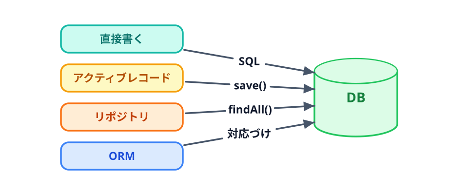

# データベースの処理のパターン

SQL はどこに書くのがよいのか、迷ったことはありませんか。DB の読み書きを書く場所の、よく使われる 4 つのパターンと、テストのしやすさのちがいを見ます。

## DB の読み書きをどこに書くか

ここで書くこと:

- 書く場所で、テストのしやすさが変わること

## 4 つのパターン

ここで書くこと（表で比べる）:

- コントローラーに直接書く: 本編の 04〜06 章の形。DB が無いと確かめられない
- アクティブレコード: データのクラス自身が `save()` を持つ（Rails・TypeORM の Active Record）。データと DB が離せず、偽物にしにくい
- リポジトリ: 本編の 07 章の形。集まりのように扱う（`findAll`・`create`）。偽物に差し替えやすい
- ORM（データマッパー）: オブジェクトと表の対応を ORM が受け持つ（Prisma・TypeORM の Data Mapper）。リポジトリと組み合わせれば差し替えられる

## 本編とのつながり

ここで書くこと:

- 04〜06 章は直接書く形、07 章はリポジトリ。だから 07 章で単体テストできるようになった

## 詳しく知りたい人へ

ここで書くこと:

- Martin Fowler の Patterns of Enterprise Application Architecture の各パターンのページ
  - [Active Record](https://martinfowler.com/eaaCatalog/activeRecord.html)
  - [Repository](https://martinfowler.com/eaaCatalog/repository.html)
  - [Data Mapper](https://martinfowler.com/eaaCatalog/dataMapper.html)
