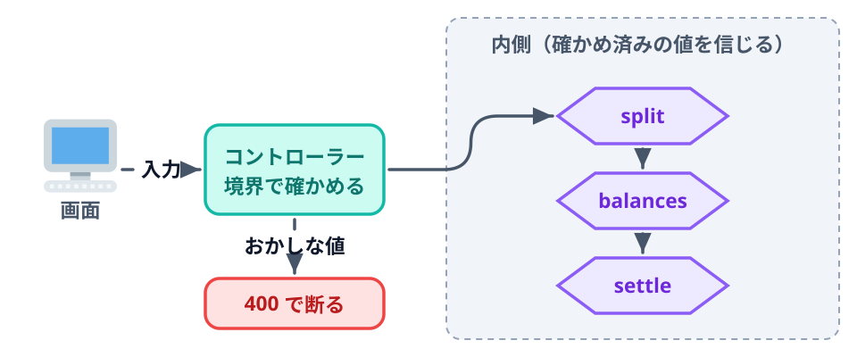

# 防御的プログラミングと攻撃的プログラミング


おかしな値が来たら、黙って直すべきか、すぐ止めるべきか、迷ったことはありませんか。2 つの考え方と、テストとの関係を見ます。

## 2 つの考え方

おかしな値が来たときの扱い方には、2 つの考え方があります。

- **防御的プログラミング** … どこでも入力を確かめ、おかしな値でも動き続けるように書く（0 人なら空の配列を返す、など）
- **攻撃的プログラミング**（fail fast）… おかしな値が来たら、その場で止めて知らせる

防御的に書くと、おかしな値が来てもアプリは止まりません。その代わり、まちがいが黙って先へ進み、離れたところでおかしな結果になって見つかります。fail fast は、まちがいが起きたその場で見つかるようにする考え方です。

## 境界で確かめ、内側は信じる

すべての関数で入力を確かめると、次のように、同じ確かめが何度も書かれます。

```ts
export function split(amount: number, count: number): number[] {
  if (!Number.isInteger(amount) || amount <= 0) throw new Error('金額が正しくない');
  if (count < 1) throw new Error('人数が 0 人');
  // …分ける計算
}

export function balances(payments: PaymentInput[]): Balance[] {
  for (const payment of payments) {
    if (!Number.isInteger(payment.amount) || payment.amount <= 0) throw new Error('金額が正しくない');
    if (payment.participantIds.length < 1) throw new Error('人数が 0 人');
  }
  // …一人ずつの差を出す計算
}

export function settle(balances: Balance[]): Transfer[] {
  for (const balance of balances) {
    if (!Number.isInteger(balance.amount)) throw new Error('金額が正しくない');
  }
  // …誰が誰に払うかの計算
}
```

確かめが計算の前に並び、何をする関数なのかが読みにくくなります。「金額は 1 円以上の整数」という決まりを変えたくなったら、全部の関数を直すことになります。

そこで、外から値が入ってくる **境界**（画面からのリクエストを受けるコントローラー）で確かめ、内側の関数は「確かめ済みの値が来る」と信じて書く、という分け方をします。



確かめは、コントローラーに 1 回だけ書きます。

```ts
@Post()
create(@Body() body: Omit<Payment, 'id'>): Payment {
  if (!Number.isInteger(body.amount) || body.amount <= 0) {
    throw new BadRequestException('金額は 1 円以上の整数にしてください');
  }
  if (body.participantIds.length < 1) {
    throw new BadRequestException('対象の人を 1 人以上選んでください');
  }
  return this.paymentsRepository.create(body);
}
```

`split`・`balances`・`settle` には、確かめを書きません。コントローラーを通った値しか届かないので、計算だけを書けます。

境界で断れない、ありえない値が内側に届いたときは、黙って直さず、すぐ止めます。

## テストとの関係

すぐ止めるコードは、テストでまちがいを見つけやすくなります。止まった場所とメッセージが、そのままテストの失敗として出るからです。

確かめる場所を決めると、テストを書く場所も決まります。入力の確かめは境界（コントローラー）の結合テストで、内側の計算は「確かめ済みの値」を前提にした単体テストで確かめます。

## このハンズオンでの例

本編のアプリは、入力を確かめていません。たとえば、対象の人を 1 人も選ばずに立て替えを記録すると、`split(10000, 0)` が呼ばれます。

`split(10000, 0)` は、空の配列 `[]` を返します。すると `balances` では、払った人に 10,000 円のプラスが付くだけで、負担する人がいません。`settle` は払う人が見つからないので、清算は空になります。10,000 円の立て替えが、黙って消えてしまいます。

直すなら、まず上のコントローラーのように境界で止め、0 人なら `400 Bad Request` で断ります。そのうえで、`split` に 0 人が届いたら例外を投げて止めておけば、境界の確かめ漏れもすぐに見つかります。

## 参考

- [Jim Shore: Fail Fast（IEEE Software）](https://martinfowler.com/ieeeSoftware/failFast.pdf) … おかしな値をその場で止める理由と、黙って直すことの問題
- [NestJS: Exception filters](https://docs.nestjs.com/exception-filters) … `BadRequestException` などで 400 を返す
