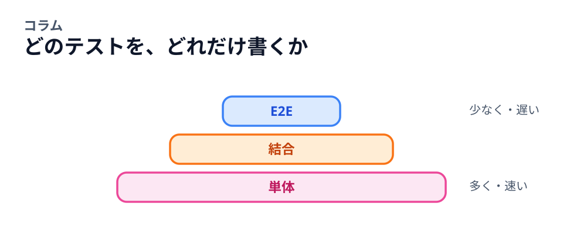

# どのテストを、どれだけ書くか

単体・結合・E2E を、それぞれどれくらい書けばよいか迷いませんか。よく使われる目安の形と、はじめの一歩を見ます。

## テストピラミッド

ここで書くこと:

- 単体を多く、結合を少し、E2E をさらに少なく
- 下ほど速く、上ほど遅いがユーザーに近い

## ほかの形

ここで書くこと:

- テストのトロフィー（結合を厚くする）など
- 何を重く見るかで形が変わる

## はじめの一歩の目安

ここで書くこと:

- 大事なユースケースを E2E で 1 本
- 決まりの多い計算を単体テストで
- つなぎ目を結合テストで
