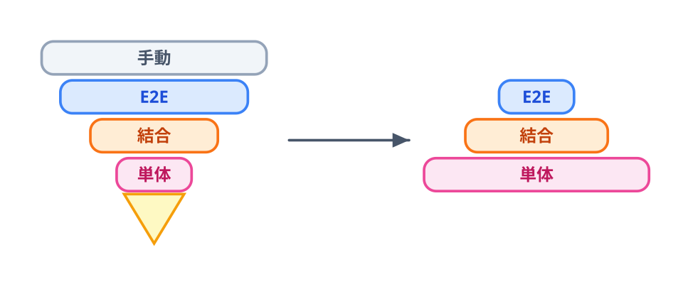

# どのテストを、どれだけ書くか

E2E テストばかり増えて、遅くて不安定になっていませんか。アイスクリームコーンからテストピラミッドへの考え方と、テストの種類とは別の「テストサイズ」という見方を見ます。

## アイスクリームコーンとテストピラミッド

手で画面を触って確かめるテストと、E2E テストが多く、単体テストが少ない形を、**アイスクリームコーン** と呼びます。自動テストを始めたばかりの現場は、画面から確かめる E2E を先に増やしがちで、この形になりやすくなります。E2E は動かすものが多いので遅く、不安定になりやすく、増えるほど流すのがつらくなります。

目指すのは、単体テストが多く、結合テストが少し、E2E がさらに少ない **テストピラミッド** の形です。

アイスクリームコーンは、一度にひっくり返そうとせず、上の層のテストを下の層へ少しずつ下ろしていきます。たとえば、E2E で確かめていた「端数の 1 円を前の人に付ける」は、[04 章](../../04-unit-test/03-more-cases/LECTURE.md) のように計算の関数の単体テストで確かめられます。

## テストの種類とテストサイズ

単体・結合・E2E という **種類** は、「何を確かめるか」で分けた名前です。これとは別に、Google は「テストを動かすのに何が要るか」で分ける **テストサイズ** を使っています。

| サイズ | 動く範囲 |
|---|---|
| Small | 1 つのプロセスの中で終わる。ファイルやネットワークを使わない |
| Medium | 1 台のマシンの中で終わる。DB や別のプロセスを使ってよい |
| Large | 1 台に収まらない。ほかのマシンや外のサービスも使う |

このハンズオンのテストに当てはめると、次のとおりです。

| テスト | 種類 | サイズ |
|---|---|---|
| [04 章](../../04-unit-test/03-more-cases/LECTURE.md) 計算の関数のテスト | 単体 | Small（関数を呼ぶだけ） |
| [07 章](../../07-di-container/04-service-test/LECTURE.md) サービスのテスト | 単体 | Small（偽物のリポジトリで、DB を使わない） |
| [05 章](../../05-integration-test/03-more-cases/LECTURE.md) 結合テスト | 結合 | Medium（一時ファイルの DB を使う） |
| [06 章](../../06-e2e-test/03-more-cases/LECTURE.md) E2E テスト | E2E | Medium（Podman の画面・API・DB とブラウザを使うが、1 台の中で動く） |

サイズを下げる方法は 2 つあります。外のサービスをテストダブルに差し替えると、1 台に収まり、Large から Medium になります。設計で外のものを切り離すと、DB も要らなくなり、Medium から Small になります。07 章で DI コンテナを使ってリポジトリを差し替えられるようにしたのは、後者です。

## 型安全はテストの代わりになるか

TypeScript の型は、多くのまちがいを、動かす前に見つけてくれます。

| 型が見つけるまちがい | 型が見つけないまちがい |
|---|---|
| 形のまちがい（`amount` に文字列を入れる、`participantIds` を書き忘れる） | 計算の答え（`split(10000, 3)` が `[3334, 3333, 3333]` か） |
| 呼び出し方のまちがい（`settle` に立て替えをそのまま渡す） | 端数の付け方や、払う回数を少なくする、といった業務の決まり |

型は「まちがったコードを書けなくする」ためのもので、テストは「動きが正しいか」を確かめるためのものです。型で防げるまちがいは、テストを書かなくても防げます。テストは、型では防げない計算や決まりに集中して書きます。

## はじめの一歩の目安

テストが 1 つも無いところから始めるなら、次の 2 つからにします。

- 大事な計算の単体テスト（Small）… 本編の `split`・`balances`・`settle` のように、まちがえると困る決まり
- いちばん大事なユースケースの E2E を 1 本 … 本編の「3 人の飲み会で清算が出る」のように、画面から最後まで通ることを確かめる

E2E を増やしたくなったら、まず、それを下の層（結合・単体）で確かめられないかを考えます。

## 参考

- [アイスクリームコーンからテストピラミッドへ（Re|vent）](https://revent.8card.net/columns/fzwfbicop1) … アイスクリームコーンからピラミッドへ少しずつ移す話と、テストサイズ
- [Alister Scott: Introducing the software testing ice-cream cone](https://watirmelon.blog/2012/01/31/introducing-the-software-testing-ice-cream-cone/) … アイスクリームコーンという名前の出どころ
- [Martin Fowler: TestPyramid](https://martinfowler.com/bliki/TestPyramid.html) … テストピラミッド
- [Software Engineering at Google: Testing Overview](https://abseil.io/resources/swe-book/html/ch11.html) … Small・Medium・Large のテストサイズ
- [TypeScript: The Basics](https://www.typescriptlang.org/docs/handbook/2/basic-types.html) … 動かす前に型でまちがいを見つける（静的な型チェック）
