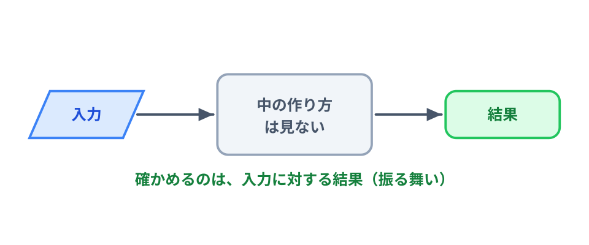

# 何をテストするか

テストを書こうとして、何を確かめればよいか手が止まったことはありませんか。確かめるところの選び方を見ます。

## 振る舞いを確かめ、作り方は確かめない

ここで書くこと:

- 入力に対する結果を確かめる
- 中の作り方（どの関数を何回呼ぶか）は確かめない

## 境界値と同値分割

ここで書くこと:

- 同じ結果になる入力をまとめ、代表を 1 つ選ぶ（同値分割）
- まとまりの境目を確かめる（境界値。0 円・1 人など）

## カバレッジとの付き合い方

ここで書くこと:

- 通った行の割合は、書き忘れを見つける手がかり
- 数字を上げること自体を目的にしない
