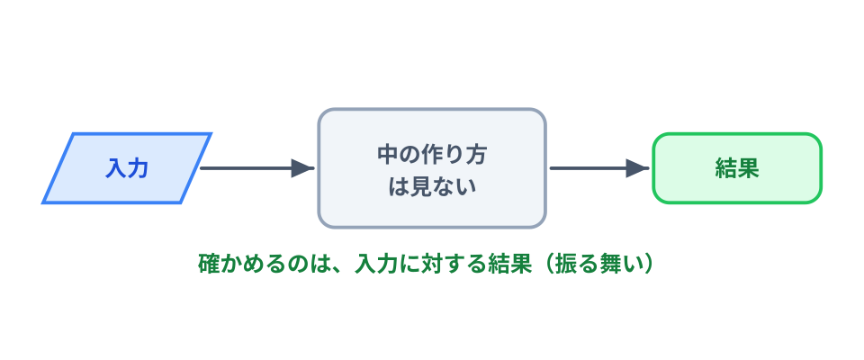

# 何をテストするか

テストを書こうとして、何を確かめればよいか手が止まったことはありませんか。確かめるところの選び方を見ます。

## 振る舞いを確かめ、作り方は確かめない

テストで確かめるのは、外から見える **振る舞い** です。関数なら「この入力に対して、この結果が返る」、API なら「このリクエストに対して、この応答が返る」を確かめます。

中の **作り方**（どの関数を何回呼ぶか、途中でどんな値を作るか）は確かめません。作り方を確かめるテストは、結果が同じでも、コードを整えるたびに落ちます。そうなると、テストがコードを直す手助けではなく、じゃまになります。

本編の [04 章のテスト](../../04-unit-test/03-more-cases/LECTURE.md) は、`split(10000, 3)` が `[3334, 3333, 3333]` を返すことを確かめていて、`split` の中で `Math.floor` を使っているかどうかは見ていません。

## 境界値と同値分割

入力はいくらでもあるので、全部は試せません。そこで、同じ結果になる入力をひとまとまりにし、代表を 1 つだけ選びます（**同値分割**）。たとえば `split` では、「割り切れる金額」は 9,000 円でも 3,000 円でも同じ扱いなので、1 つ選べば足ります。

まちがいは、まとまりの境目で起きやすいので、境目はかならず試します（**境界値**）。`split` なら、0 円、1 人、割り切れる・割り切れないの境目が当たります。[04 章の設計の表](../../04-unit-test/01-design/LECTURE.md) の S1〜S4 は、この考え方で選んでいます。

## カバレッジとの付き合い方

**カバレッジ** は、テストを流したときに、コードの何割の行や分かれ道が実行されたかの割合です。Vitest では `npm run test:cov` で出せます（`nest new` が用意しています）。

カバレッジは、テストが 1 度も通っていないところ、つまり書き忘れを見つける手がかりとして使います。数字を上げること自体を目的にすると、結果を確かめないテストでも数字は上がってしまうので、目標の数字にはしません。

## 参考

- [Software Engineering at Google: Unit Testing](https://abseil.io/resources/swe-book/html/ch12.html) … 作り方ではなく、公開された振る舞いを確かめる
- [Martin Fowler: TestCoverage](https://martinfowler.com/bliki/TestCoverage.html) … カバレッジは、テストされていないところを見つける道具
- [Vitest: Coverage](https://vitest.dev/guide/coverage) … カバレッジの出し方
