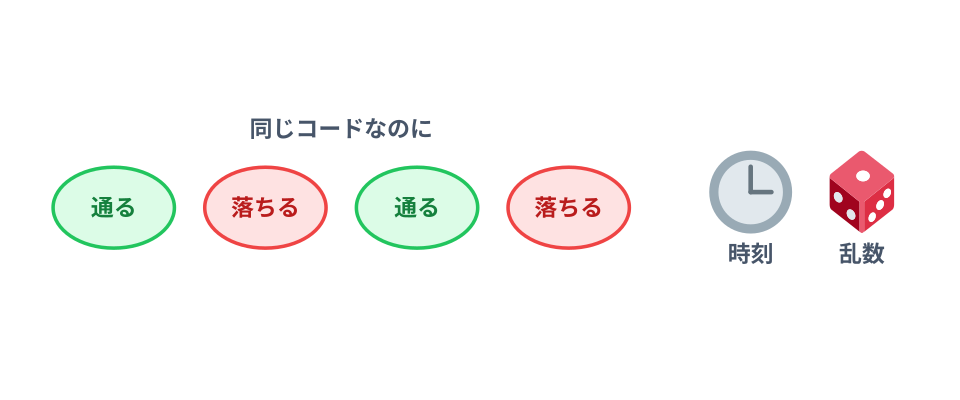

# 不安定なテストと扱いにくいもの

同じコードなのに、流すたびに通ったり落ちたりするテストに困ったことはありませんか。原因と、時刻や乱数の扱い方を見ます。

## 不安定なテストの原因

ここで書くこと:

- 残ったデータ・テストの順番・待ち時間
- 本編の E2E では、前のデータが残っていると、たまたま通ってしまうことがあった

## 時刻・乱数・外のサービス

ここで書くこと:

- 引数で渡す、差し替えられるようにする
- DI コンテナで差し替えると、テストで決まった値にできる
