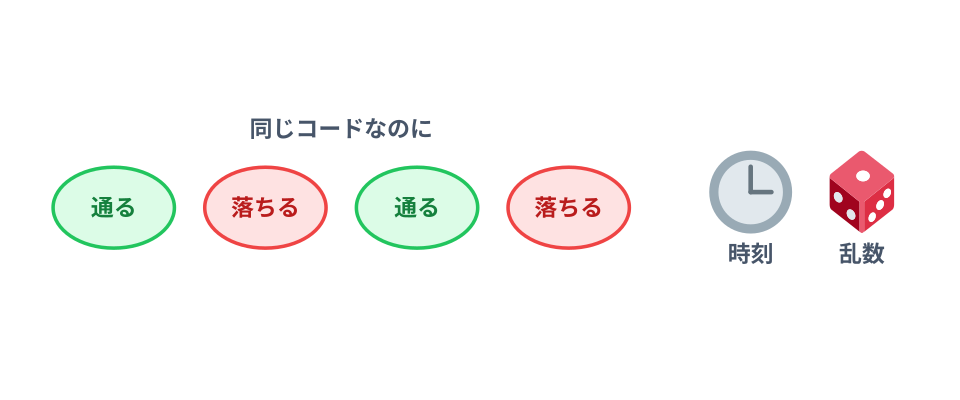

# 不安定なテストと扱いにくいもの



同じコードなのに、流すたびに通ったり落ちたりするテストに困ったことはありませんか。原因と、時刻や乱数の扱い方を見ます。

## 不安定なテストの原因

コードを変えていないのに、流すたびに通ったり落ちたりするテストを、**不安定なテスト**（flaky test）と呼びます。不安定なテストが 1 つあると、落ちても「またか」と流されるようになり、本当のまちがいを見逃します。

よくある原因は 3 つです。

- **残ったデータ** … 前のテストや前の実行が入れたデータが残っていて、結果が変わる
- **テストの順番** … あるテストが、前のテストの作ったデータに頼っていて、順番が変わると落ちる
- **待ち時間** … 画面や API の応答を、決まった秒数だけ待って確かめる。速いときは通り、遅いときは落ちる

本編の E2E でも、前のデータが残っていると、メンバーの数を確かめるところで、たまたま通ってしまうことがありました。[06 章](../../06-e2e-test/02-first-test/LECTURE.md) では、テストの最初に API でデータが空であることを確かめ、`podman compose down --volumes` でデータを消してから流すようにしています。待ち時間は、Playwright の `toHaveCount()` のように、期待どおりになるまで待つ確かめ方を使い、決まった秒数の `sleep` は書きません。[05 章の結合テスト](../../05-integration-test/02-first-test/LECTURE.md) が、テストごとに新しい DB を作るのも、残ったデータと順番の影響をなくすためです。

## 時刻・乱数・外のサービス

今の時刻・乱数・外のサービスの応答は、流すたびに変わります。これをそのまま使うコードは、テストで結果を決められません。

いちばん簡単なのは、変わるものを **引数で受け取る** 形にすることです。

```ts
// 「今」を中で作らず、受け取る。テストでは決まった日時を渡せる
export function isOverdue(dueDate: Date, now: Date): boolean {
  return now > dueDate;
}
```

クラスの中で使うときは、[07 章の DI コンテナ](../../07-di-container/01-database-provider/LECTURE.md) で受け取る形にしておけば、テストで差し替えられます。リポジトリを偽物にしたのと同じやり方で、時刻を返すものや外のサービスの呼び出しも、決まった値を返す偽物にできます。NestJS のテストでは、`overrideProvider()` で、登録したプロバイダーを偽物に差し替えられます。

すでに `new Date()` を中で使っているコードは、Vitest の `vi.useFakeTimers()` と `vi.setSystemTime()` で、テストの間だけ時刻を決めることもできます。

## 参考

- [Martin Fowler: Eradicating Non-Determinism in Tests](https://martinfowler.com/articles/nonDeterminism.html) … 不安定なテストの原因（残ったデータ・順番・待ち時間・時刻）と、隔離して直すこと
- [Playwright: Auto-waiting](https://playwright.dev/docs/actionability) … 操作や確かめの前に、期待どおりになるまで待つ
- [NestJS: Testing](https://docs.nestjs.com/fundamentals/testing) … `overrideProvider()` でプロバイダーを差し替える
- [Vitest: Mocking Timers](https://vitest.dev/guide/mocking/timers) … `vi.useFakeTimers()`・`vi.setSystemTime()`
