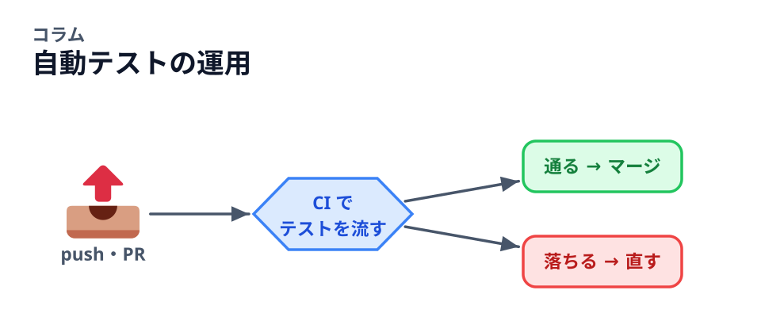

# 自動テストの運用

テストを書いたのに、いつのまにか誰も流さなくなった、ということはありませんか。テストを続けて役立てるための運用を見ます。

## CI で流す

ここで書くこと:

- push や PR のたびに GitHub Actions で流す
- 通らなければマージしない

## 落ちたときの扱い

ここで書くこと:

- すぐ直す
- 無効にして放置しない
- 不安定なテストは隔離して直す

## 速さを保つ

ここで書くこと:

- 単体と、結合・E2E を分けて流す
- 遅いテストを見つける

## テストも保守するコード

ここで書くこと:

- 仕様が変わったらテストも直す
- 重複を減らす
- 名前で意図を書く

## テストの無いコードに足す

ここで書くこと:

- 今の動きを写すテストから始める
- 計算を取り出してから単体テストする
