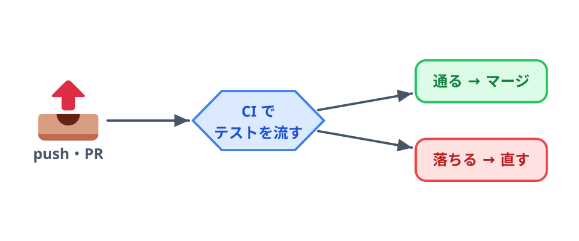

# 自動テストの運用



テストを書いたのに、いつのまにか誰も流さなくなった、ということはありませんか。テストを続けて役立てるための運用を見ます。

## CI で流す

テストは、手元で流すのを忘れると役に立ちません。push や PR のたびに、CI（継続的インテグレーション）で自動で流します。GitHub なら GitHub Actions を使います。

このハンズオンのプロジェクトなら、次のファイル（`.github/workflows/test.yml`）を置くと、push と PR のたびに、単体テストと結合テストが流れます。

```yaml
name: test
on: [push, pull_request]
jobs:
  test:
    runs-on: ubuntu-latest
    defaults:
      run:
        working-directory: apps/api
    steps:
      - uses: actions/checkout@v4
      - uses: actions/setup-node@v4
        with:
          node-version: 26
          cache: npm
          cache-dependency-path: apps/api/package-lock.json
      - run: npm ci
      - run: npm test
      - run: npm run test:e2e
```

さらに、GitHub のブランチの保護で、このテストが通らない PR はマージできないようにしておきます。

## 落ちたときの扱い

CI でテストが落ちたら、すぐに直します。落ちたまま放っておくと、次に落ちたテストに気づけなくなります。

テストを無効にして（`it.skip` など）そのままにしておくのは避けます。不安定なテストは、ほかのテストと分けて（隔離して）流し、原因を見つけて直してから戻します（[不安定なテストと扱いにくいもの](../09-flaky/LECTURE.md)）。

## 速さを保つ

テストが遅くなると、流す回数が減ります。速い単体テスト（`npm test`）と、時間のかかる結合テスト・E2E を分けておき、単体テストは手元で何度も、結合テストと E2E は CI で、と流し方を分けます。本編で単体テストと結合テストを別のコマンドにしているのは、このためです。

Vitest も Playwright も、テストごとにかかった時間を表示します。遅いテストが増えてきたら、下の層のテストに置き換えられないかを考えます（[どのテストを、どれだけ書くか](../06-how-many/LECTURE.md)）。

## テストも保守するコード

テストも、アプリのコードと同じように直していくコードです。

- 仕様が変わったら、コードと一緒にテストも直す
- 同じ用意をくり返し書かない（本編の結合テストの `seed()` のように、まとめる）
- テストの名前に、確かめる決まりを書く（本編の「割り切れないときは、前の人から 1 円ずつ足し、合計を元の金額と同じにする」のように、落ちたときに名前だけで何が破れたか分かるようにする）

## テストの無いコードに足す

テストの無いコードにテストを足すときは、まず、今の動きをそのまま写すテストから始めます。正しいかどうかではなく「今こう動いている」を確かめるテストで、書き換えても動きが変わっていないことを確かめる足場になります。本編で、04〜06 章のテストを先に書いてから [07 章](../../07-di-container/01-database-provider/LECTURE.md) で書き換えたのも、この順番です。

そのうえで、計算を DB や HTTP から取り出し、取り出した計算を単体テストします。

## 参考

- [GitHub Docs: Building and testing Node.js](https://docs.github.com/en/actions/use-cases-and-examples/building-and-testing/building-and-testing-nodejs) … GitHub Actions で Node.js のテストを流す
- [GitHub Docs: About protected branches](https://docs.github.com/en/repositories/configuring-branches-and-merges-in-your-repository/managing-protected-branches/about-protected-branches) … テストが通らないとマージできないようにする
- [Martin Fowler: Continuous Integration](https://martinfowler.com/articles/continuousIntegration.html) … 変更のたびにビルドとテストを流し、壊れたらすぐ直す
- [Martin Fowler: Eradicating Non-Determinism in Tests](https://martinfowler.com/articles/nonDeterminism.html) … 不安定なテストを隔離して直す
- [Michael Feathers: Characterization Testing](https://michaelfeathers.silvrback.com/characterization-testing) … 今の動きを写すテストから始める
